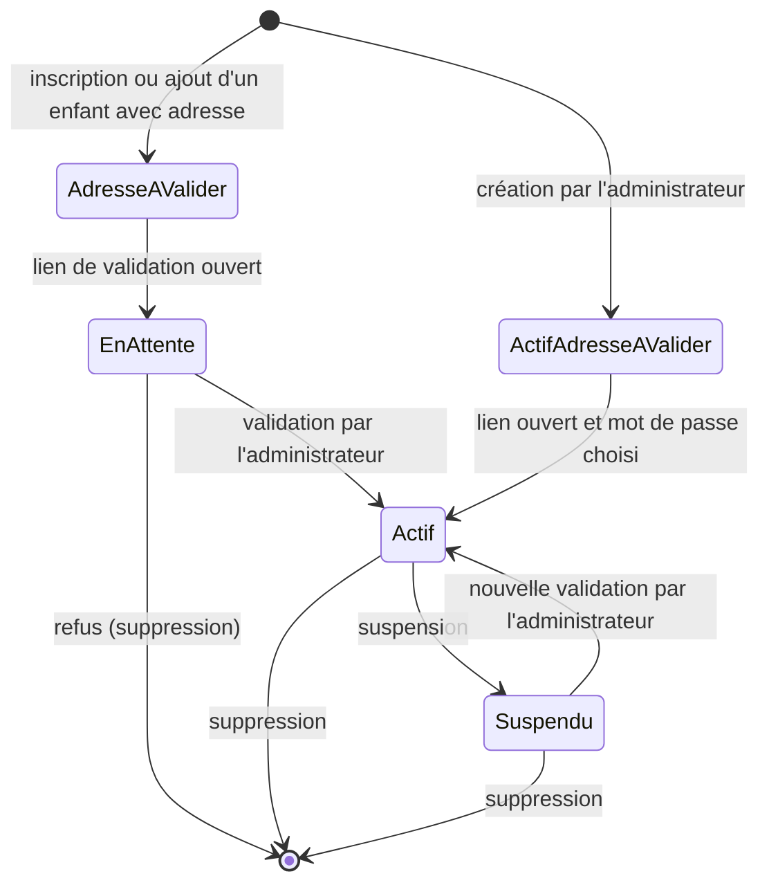

# Spécifications fonctionnelles de l'existant : Centre Art & Danse

> **Objet** : description fonctionnelle de l'application « Centre Art & Danse » telle qu'elle existe aujourd'hui : contexte, utilisateurs et rôles, fonctionnalités, parcours et écrans.
> **Version** : 1.0
> **Date** : 19/11/2026
> **Rédigé par** : Ecaterina Munteanu, développeuse, VNWeb

---

## 1. Contexte

### 1.1 L'école et l'application
« Centre Art & Danse » est une école de danse. Son application, développée et maintenue par l'agence VNWeb (Antibes), sert à deux choses :
- **communiquer** : la direction et les professeurs publient une seule fois pour un cours ou pour toute l'école, au lieu d'écrire à chaque famille ;
- **gérer** : la direction contrôle les comptes (professeurs, parents, élèves) et les cours, et les parents suivent les cours de leurs enfants.

L'application s'utilise dans un navigateur et s'installe sur l'écran d'accueil d'un téléphone comme une application classique, sans passer par une boutique d'applications (PWA). Elle envoie des notifications sur le téléphone, même lorsqu'elle est fermée. Son nom court sur l'appareil est « CAD ».

La majorité des utilisateurs sont des mineurs : les élèves de 15 ans ou plus peuvent avoir leur propre compte, les plus jeunes sont gérés par un parent.

### 1.2 Origine de ce document
À mon arrivée sur le projet, l'application était terminée et déployée en préproduction, sans cahier des charges ni documentation fonctionnelle ou technique. Ce document reconstitue son fonctionnement réel à partir de l'utilisation de l'application, de la lecture de son code et des échanges avec l'équipe. Il décrit ce qui existe, sans jugement ni proposition : les écarts et les améliorations sont traités dans le cahier des charges de mon intervention.

### 1.3 Périmètre fonctionnel
| L'application couvre | L'application ne couvre pas |
|---|---|
| Comptes, rôles et validation des inscriptions | Paiement, facturation, inscriptions administratives à l'école |
| Gestion des enfants par leurs parents, second parent ou tuteur | Planning des cours, gestion de la présence |
| Cours et groupes, inscription et suivi | Messagerie de groupe (la communication de groupe passe par les publications) |
| Publications avec photos et vidéos, mentions « j'aime », commentaires | Modification d'une publication ou d'un commentaire après envoi |
| Messagerie privée entre deux personnes | Accès sans compte (seules les pages de connexion sont publiques) |
| Notifications sur le téléphone et courriels automatiques | Autre langue que le français |
| Espace d'administration et guide d'utilisation intégré | |

### 1.4 Vocabulaire
| Terme | Sens dans l'application |
|---|---|
| Groupe | Discipline portant un nom, par exemple « Jazz moderne » |
| Cours | Classe d'un groupe à un niveau donné, avec une photo, par exemple « Jazz moderne, débutant ». Les cours de même nom forment un groupe |
| S'inscrire à un cours | Pour un élève : suivre ce cours. Pour un professeur : l'enseigner. Section « Mes cours » du profil |
| Suivre un groupe | Recevoir ses publications sans y être inscrit, par exemple un parent qui suit les cours de son enfant. Section « Mes groupes suivis » du profil |
| Superviseur | Parent ou tuteur rattaché à un ou plusieurs élèves |
| Publication | Message d'un professeur ou de l'administrateur, pour toute l'école (publication générale) ou pour un groupe |
| Suspension | Désactivation d'un compte sans effacer ses données |
| Notification | Message reçu sur le téléphone ou l'ordinateur, même application fermée |

## 2. Utilisateurs et rôles

### 2.1 Rôles
| Rôle | Qui | Ce qui le caractérise |
|---|---|---|
| Administrateur | Le dirigeant de l'école | Accès à l'espace d'administration et à toutes les publications ; peut supprimer toute publication ou tout commentaire |
| Professeur | Un enseignant | Publie, choisit les cours qu'il enseigne |
| Superviseur | Un parent ou un tuteur | Gère le compte de ses enfants et suit leurs cours |
| Élève | Un élève de 15 ans ou plus avec son propre compte, ou un enfant créé par son parent | Choisit ses cours, suit des groupes |
| Élève-superviseur | Un élève qui est aussi parent d'un autre élève | Cumule les droits de l'élève et du superviseur |

Chaque compte a un seul rôle. À l'inscription, une personne choisit entre « Je suis élève », « Je suis parent d'élève » et « Je suis parent et je suis élève » ; seul l'administrateur crée les comptes de professeurs.

### 2.2 Matrice des droits
| Action | Administrateur | Professeur | Superviseur | Élève | Élève-superviseur |
|---|:-:|:-:|:-:|:-:|:-:|
| Consulter le fil d'accueil | Tout | Général et ses groupes | Général et ses groupes | Général et ses groupes | Général et ses groupes |
| Ouvrir la page d'un groupe et ses publications | Oui | Oui | Oui | Oui | Oui |
| Aimer une publication | Oui | Oui | Oui | Oui | Oui |
| Commenter une publication | Oui | Oui | Oui | Oui | Oui |
| Publier | Oui | Oui | Non | Non | Non |
| Supprimer une publication | Toutes | Les siennes | Non | Non | Non |
| Supprimer un commentaire | Tous | Les siens | Les siens | Les siens | Les siens |
| S'inscrire à des cours (« Mes cours ») | Non | Oui, pour enseigner | Non | Oui | Oui |
| Suivre des groupes | Non | Oui | Oui | Oui | Oui |
| Gérer des enfants (« Mes enfants ») | Non | Oui | Oui | Non | Oui |
| Inviter un second superviseur | Non | Oui | Oui | Non | Oui |
| Messagerie privée | Oui | Oui | Oui | Oui | Oui |
| Espace d'administration et guide d'utilisation | Oui | Non | Non | Non | Non |

Les conditions propres à chaque action (commentaire sur une publication de groupe, suppression d'un enfant, etc.) sont précisées dans la section 4.

## 3. Cycle de vie d'un compte

### 3.1 Trois façons de créer un compte
| Création | Par qui | Étapes avant de pouvoir se connecter |
|---|---|---|
| Inscription | La personne elle-même, 15 ans ou plus | 1. Valider son adresse courriel. 2. Attendre la validation par l'administrateur |
| Création par l'administrateur | L'administrateur | 1. Valider son adresse courriel. 2. Choisir son mot de passe. Le compte est actif d'emblée |
| Ajout d'un enfant | Un parent, depuis son profil | Sans adresse courriel : aucun accès propre, l'enfant est géré par le parent. Avec une adresse : 1. Valider l'adresse. 2. Choisir son mot de passe (lien reçu par courriel). 3. Attendre la validation par l'administrateur |

### 3.2 États d'un compte

- **Adresse à valider** : le compte figure dans la liste « Courriels non vérifiés » de l'administration.
- **En attente** : le compte figure dans la liste « Validation » de l'administration ; la connexion est refusée.
- **Suspendu** : les données sont conservées, la connexion est refusée et la personne disparaît de la liste des destinataires de la messagerie. Un compte suspendu réapparaît dans la liste « Validation », d'où l'administrateur peut le réactiver.
- **Suppression** : définitive, le compte et ses données sont effacés. « Supprimer » et « bannir » désignent cette même opération.

## 4. Fonctionnalités

### 4.1 Accès au compte
| Fonction | Fonctionnement |
|---|---|
| Inscription | Saisie de l'adresse courriel, du nom, du prénom, de la date de naissance, du type de compte et du mot de passe (8 caractères au moins, saisi deux fois). Refus si la personne a moins de 15 ans ou si l'adresse est déjà utilisée. Un courriel « Vérification du compte » est envoyé |
| Validation de l'adresse | Le lien reçu est valable une heure. S'il a expiré, la page propose d'en recevoir un nouveau, ce qui est refusé tant qu'un lien valable existe. Une fois l'adresse validée, les administrateurs reçoivent une notification « Nouvelle inscription » |
| Connexion | Par adresse courriel et mot de passe. Refusée tant que l'adresse n'est pas validée ou que le compte n'est pas actif. Après trois échecs en une minute pour une même adresse depuis un même réseau, les tentatives sont bloquées vingt minutes. La session dure un jour, puis il faut se reconnecter |
| Déconnexion | Depuis le menu, ferme la session sur l'appareil |
| Mot de passe oublié | La personne saisit son adresse et reçoit un lien valable une heure ; la réponse affichée est la même que l'adresse existe ou non, et aucun nouveau lien n'est envoyé tant que le précédent est valable. Elle choisit un nouveau mot de passe et peut déconnecter tous ses appareils |
| Profil | Modification du nom, du prénom, de la date de naissance, du téléphone et de l'adresse postale. Ajout, remplacement ou retrait de la photo de profil |
| Changement d'adresse courriel | La nouvelle adresse est saisie deux fois. Elle ne remplace l'ancienne qu'après clic sur le lien envoyé à la nouvelle adresse, valable une semaine |

### 4.2 Enfants et supervision
| Fonction | Fonctionnement |
|---|---|
| Ajouter un enfant | Saisie du prénom, du nom, de la date de naissance, d'une adresse courriel facultative et des cours suivis. L'enfant est inscrit aux cours choisis et rattaché au parent qui l'a créé |
| Modifier un enfant | Modification du prénom, du nom, de la date de naissance et des cours suivis |
| Retirer un enfant | Après confirmation, supprime définitivement le compte de l'enfant. Seul un superviseur rattaché à l'enfant peut le faire |
| Inviter un second superviseur | Pour un enfant de rôle élève, le parent saisit une ou plusieurs adresses (cas d'un second parent ou d'un tuteur). Si l'adresse correspond à un compte, la personne reçoit une notification « Nouvelle invitation » ; sinon, un courriel « Invitation à vous connecter » |
| Répondre à une invitation | La personne invitée voit l'invitation dans son profil. Si elle accepte, elle devient superviseur de l'enfant ; si elle refuse, l'invitation disparaît. Une personne déjà superviseur de cet enfant ne peut pas accepter une seconde fois |

### 4.3 Cours et groupes
| Fonction | Fonctionnement |
|---|---|
| Consulter les groupes | La page Groupes présente les groupes et leurs cours, les professeurs et les élèves. Chaque groupe a une page de détail avec ses publications et ses membres |
| Choisir ses cours | Depuis la section « Mes cours » du profil, l'élève coche les cours qu'il suit et le professeur ceux qu'il enseigne. L'effet est immédiat, sans validation d'un tiers |
| Suivre des groupes | Depuis la section « Mes groupes suivis » du profil, l'utilisateur coche les groupes dont il veut recevoir les publications, par exemple ceux de ses enfants. L'effet est immédiat |
| Premiers pas | À la première connexion, une fenêtre invite l'élève à choisir ses cours, le professeur à choisir les cours qu'il enseigne et le parent à suivre les cours de ses enfants |

### 4.4 Publications
| Fonction | Fonctionnement |
|---|---|
| Publier | Le professeur ou l'administrateur rédige un texte et ajoute jusqu'à dix photos ou vidéos, pour toute l'école ou pour un groupe. Les liens collés dans le texte s'affichent avec un aperçu (titre, image, icône du site) |
| Fil d'accueil | Affiche, de la plus récente à la plus ancienne, les publications générales et celles des groupes auxquels l'utilisateur est inscrit ou qu'il suit. L'administrateur voit toutes les publications |
| Mention « j'aime » | Un clic ajoute la mention, un second clic la retire ; le nombre de mentions est affiché |
| Commentaires | Ajout d'un commentaire ou d'une réponse à un commentaire. Sur une publication de groupe, seuls les membres du groupe et l'administrateur peuvent commenter ; sur la page d'un groupe, la zone de saisie n'est proposée qu'aux personnes inscrites au cours et à l'administrateur. Un commentaire supprimé par son auteur ou par l'administrateur disparaît de l'affichage |
| Supprimer une publication | L'auteur ou l'administrateur supprime la publication après confirmation ; elle disparaît pour tous |

### 4.5 Messagerie privée
| Fonction | Fonctionnement |
|---|---|
| Écrire à quelqu'un | L'utilisateur choisit un destinataire parmi tous les comptes actifs de l'école. Deux personnes n'ont qu'une seule conversation entre elles |
| Échanger | Les messages arrivent en temps réel, avec indication « en train d'écrire » et état de lecture. Le destinataire reçoit une notification « Nouveau message » |
| Messages non lus | Les conversations contenant des messages non lus sont signalées, ainsi que l'entrée Messagerie du menu |
| Masquer une conversation | Après confirmation, la conversation disparaît de la liste de la personne qui la masque uniquement. Elle réapparaît dès qu'un nouveau message est envoyé |

### 4.6 Notifications et courriels
L'utilisateur active les notifications depuis un bouton de l'application, puis les accepte sur son appareil. L'auteur d'une action ne reçoit pas la notification qu'elle déclenche.

| Événement | Destinataire | Notification |
|---|---|---|
| Publication générale | Tous les utilisateurs | « Nouveau post » |
| Publication de groupe | Les membres du groupe | « Nouveau post », avec un lien vers le groupe |
| Message privé | Le destinataire | « Nouveau message » |
| Adresse validée par un nouveau compte | Les administrateurs | « Nouvelle inscription » |
| Invitation de supervision, personne ayant un compte | La personne invitée | « Nouvelle invitation » |

Les courriels partent de l'adresse noreply@centreartetdanse.com, avec le logo de l'école.

| Courriel | Envoyé quand | Contenu |
|---|---|---|
| Vérification du compte | Inscription, création par l'administrateur, ajout d'un enfant avec adresse, renvoi d'un lien | Lien de validation de l'adresse, valable une heure |
| Réinitialisation du mot de passe | Mot de passe oublié ; adresse validée par un enfant rattaché à un parent | Lien pour choisir un mot de passe, valable une heure |
| Validation du nouvel email | Changement d'adresse courriel | Lien de confirmation, valable une semaine |
| Invitation à vous connecter | Invitation de supervision vers une adresse sans compte | Lien vers l'application |

### 4.7 Administration
L'espace d'administration comprend quatre onglets, chacun avec une recherche.

| Onglet | Fonctions |
|---|---|
| Utilisateurs | Statistiques des comptes actifs (total et par rôle) ; liste des comptes actifs ; fiche d'un utilisateur pour modifier son nom, son prénom, son adresse courriel (confirmée par lien), son téléphone, sa date de naissance et son rôle, ou retirer sa photo ; suspension ; suppression ; création d'un compte (adresse, nom, prénom, date de naissance, rôle) |
| Validation | Liste des comptes dont l'adresse est validée mais qui ne sont pas actifs (nouvelles inscriptions et comptes suspendus) ; validation ou refus. Un refus supprime le compte |
| Courriels non vérifiés | Liste des comptes dont l'adresse n'est pas validée ; renvoi d'un lien de validation, refusé si un lien valable existe déjà |
| Cours | Liste des cours ; création (nom du groupe, niveau, photo facultative, remplacée par le logo de l'école si absente) ; modification ; suppression. Deux cours ne peuvent pas avoir le même nom et le même niveau. Noms et niveaux sont libres |

### 4.8 Photos et vidéos
| Média | Formats acceptés | Limites |
|---|---|---|
| Photo de profil | jpg, png, webp | 2 Mo |
| Photo d'un cours | jpg, jpeg, png, webp | 10 Mo |
| Médias d'une publication | Photos jpg, jpeg, png, webp ; vidéos mp4, mov, webm, ogg | 10 fichiers, 500 Mo par fichier |

Les photos des publications sont converties dans un format léger pour l'affichage ; les vidéos sont compressées et reçoivent une image d'aperçu.

### 4.9 Aide et installation
- **Guide d'utilisation** : une page d'aide intégrée explique l'installation sur iPhone et Android, la création de compte, la connexion, le mot de passe oublié, la navigation, les actualités, les groupes, la messagerie et l'administration. Elle n'est accessible qu'à l'administrateur.
- **Invitation à installer** : sur téléphone, lorsque l'application n'est pas installée, une fenêtre explique comment l'ajouter à l'écran d'accueil.

## 5. Parcours types

**Arrivée d'un élève de 15 ans ou plus**
Inscription → courriel « Vérification du compte » → ouverture du lien dans l'heure → validation du compte par l'administrateur → connexion → choix de ses cours à la première connexion → fil d'accueil.

**Arrivée d'une famille avec un enfant de moins de 15 ans**
Le parent s'inscrit et suit le parcours précédent → depuis son profil, il ajoute son enfant et ses cours → il suit les groupes de son enfant pour recevoir leurs publications → s'il le souhaite, il invite le second parent, qui accepte l'invitation depuis son propre profil.

**Communication d'un professeur avec un cours**
Le professeur choisit dans « Mes cours » les cours qu'il enseigne → il publie dans le groupe un texte avec photos ou vidéos → les membres du groupe reçoivent une notification et voient la publication dans leur fil → ils peuvent aimer et commenter.

**Échange privé**
Messagerie → choix du destinataire → envoi → le destinataire reçoit une notification et répond en temps réel.

## 6. Écrans et navigation

### 6.1 Navigation
Le menu principal donne accès à l'Accueil, aux Groupes et à la Messagerie. Le menu du compte donne accès au Profil, à l'Aide, à la Déconnexion et, pour l'administrateur, à l'Administration. Sans connexion, seules la page de connexion, la page de validation d'adresse et la page de choix du mot de passe sont accessibles ; toute autre adresse ramène à l'accueil ou à la connexion.

### 6.2 Écrans
| Écran | Contenu | Utilisateurs |
|---|---|---|
| Connexion | Connexion, inscription, mot de passe oublié, explication des types de compte | Personnes non connectées |
| Validation de l'adresse | Résultat de l'ouverture du lien ; demande d'un nouveau lien ; choix du mot de passe pour un compte créé par l'administrateur | Personnes non connectées |
| Nouveau mot de passe | Choix d'un mot de passe à partir d'un lien reçu | Personnes non connectées |
| Accueil | Fil des publications, création d'une publication | Tous |
| Groupes | Groupes et cours, professeurs, élèves | Tous |
| Détail d'un groupe | Publications et membres du groupe | Tous |
| Messagerie | Liste des conversations et échanges | Tous |
| Profil | Informations personnelles, Mes cours, Mes groupes suivis, Mes enfants, invitations reçues | Tous, sections selon le rôle |
| Administration | Onglets Utilisateurs, Validation, Courriels non vérifiés, Cours | Administrateur |
| Aide | Guide d'utilisation | Administrateur |

### 6.3 Comportements généraux
- **Langue** : toute l'interface et tous les messages sont en français.
- **Affichage** : conçu d'abord pour le téléphone, utilisable sur tablette et ordinateur. Le thème clair ou sombre suit le réglage de l'appareil.
- **Retours à l'utilisateur** : chaque action affiche un message de confirmation ou d'erreur ; les suppressions demandent une confirmation.
- **Compte non actif** : une personne dont le compte a été suspendu pendant qu'elle était connectée voit un écran « Votre compte est en attente de validation » à la place de l'application.

## 7. Informations gérées
| Information | Contenu |
|---|---|
| Compte | Adresse courriel, mot de passe, nom, prénom, date de naissance, téléphone, adresse postale, photo, rôle, état du compte |
| Liens familiaux | Rattachement entre un superviseur et un enfant ; invitations de supervision en attente |
| Cours et rattachements | Nom, niveau et photo de chaque cours ; inscriptions aux cours et groupes suivis de chaque utilisateur |
| Publications | Texte, photos et vidéos, mentions « j'aime », commentaires et réponses |
| Messagerie | Conversations, messages, état de lecture, masquage par participant |
| Notifications | Appareils sur lesquels l'utilisateur a activé les notifications |

Le modèle de données détaillé figure dans les spécifications techniques de l'existant.

## 8. Validation du document

| Partie prenante | Nom | Rôle | Décision | Date |
|---|---|---|---|---|
| VNWeb | Vincent Nilles | Maître d'apprentissage | | |
| VNWeb | Ecaterina Munteanu | Rédactrice | Rédigé | 19/11/2026 |
