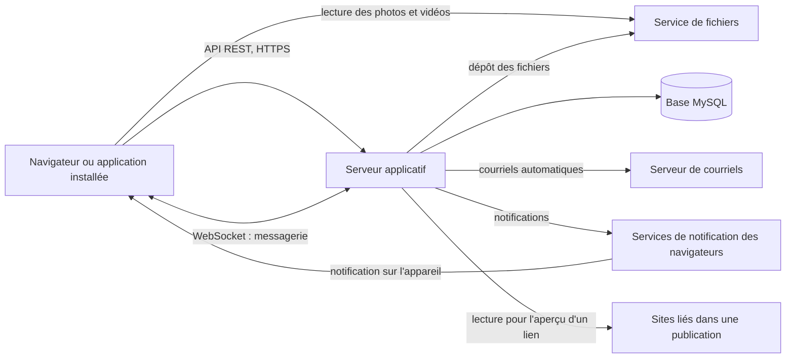
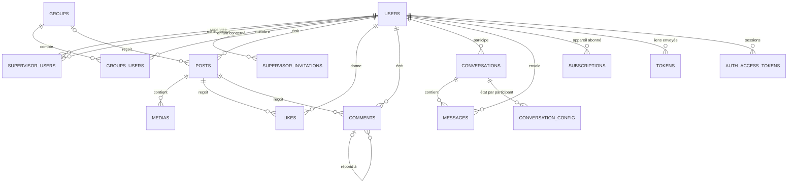

# Spécifications techniques de l'existant : Centre Art & Danse

> **Objet** : dossier d'architecture de l'application « Centre Art & Danse » telle qu'elle existe aujourd'hui : composants, données, environnements, dépendances, et état des lieux de la sécurité et de la conformité RGPD.
> **Version** : 1.0
> **Date** : 19/11/2026
> **Rédigé par** : Ecaterina Munteanu, développeuse, VNWeb

---

## 1. Objet et sources

Ce document complète les spécifications fonctionnelles de l'existant : celles-ci décrivent ce que fait l'application, celui-ci décrit comment elle est construite et dans quel état elle se trouve. Comme pour le volet fonctionnel, aucune documentation technique n'existait à mon arrivée. Tout ce qui suit est reconstitué à partir de la lecture du code des trois composants, de leur configuration et des analyses automatiques lancées au début de mon intervention.

Le document décrit et constate. Les corrections et les évolutions sont traitées dans le cahier des charges de mon intervention, qui s'appuie sur les constats numérotés des sections 10 et 11.

---

## 2. Vue d'ensemble

### 2.1 Les trois composants

| Composant | Rôle | Technologie principale | Adresse en production |
|---|---|---|---|
| Interface (app.cad) | Application installable (PWA) utilisée par l'école, les familles et les élèves | React 19, Vite 6 | app.centreartetdanse.com |
| Serveur applicatif (api.cad) | Logique métier, accès aux données, authentification, messagerie en temps réel, courriels et notifications | AdonisJS 6, TypeScript, MySQL | api.centreartetdanse.com |
| Service de fichiers (cdn.cad) | Réception, conversion et diffusion des photos et vidéos | Express 5, Multer, ffmpeg | cdn.centreartetdanse.com |

Chaque composant a son propre dépôt, ses propres dépendances et son propre déploiement. Seul le serveur applicatif accède à la base de données. Le service de fichiers ne partage ni code ni base avec lui.

### 2.2 Schéma d'architecture

Les fichiers ne vont pas directement du navigateur au service de fichiers. L'interface les envoie au serveur applicatif, qui les transmet au service de fichiers puis enregistre en base l'adresse de diffusion renvoyée. Le navigateur lit ensuite les fichiers directement sur le service de fichiers.

---

## 3. Interface

### 3.1 Technologies
| Usage | Bibliothèque |
|---|---|
| Interface | React 19 |
| Construction et serveur de développement | Vite 6 |
| Navigation entre les écrans | React Router 6 |
| État de l'application (session, publications, groupes, messagerie, administration) | Zustand 5 |
| Mise en forme | Bootstrap 5, React Bootstrap, Sass |
| Tableaux de l'espace d'administration | AG Grid |
| Animations | Framer Motion |
| Textes et traduction (français seul) | i18next |
| Messagerie en temps réel | client socket.io |
| Messages d'information à l'écran | React Hot Toast |

Trois bibliothèques sont déclarées mais utilisées nulle part dans le code : Ionic React, Firebase et un module de stockage local pour mobile. Firebase a pourtant un projet associé, dont une clé figure dans l'historique du dépôt du serveur applicatif (constat S-13).

### 3.2 Organisation du code
Le code est découpé par domaine fonctionnel : authentification, profil, mur de publications, groupes, messagerie, administration. Chaque domaine regroupe ses écrans et ses composants. Les appels au serveur passent par deux clients HTTP qui coexistent, une ancienne et une nouvelle version.

### 3.3 Session et fonctionnement hors du navigateur
- **Jeton de connexion** : après la connexion, le jeton renvoyé par le serveur est enregistré dans un cookie nommé « CAD_TK », valable 24 heures, créé par le code de l'interface. Ce cookie est donc lisible par le code exécuté dans la page. Il porte les attributs SameSite=Lax et, hors développement, Secure.
- **Service worker** : un script tourne en arrière-plan du navigateur pour recevoir et afficher les notifications. Quand le navigateur renouvelle l'abonnement aux notifications, ce script prévient le serveur à une adresse de préproduction écrite en dur.
- **Installation** : un manifeste décrit l'application installée (nom court « CAD », plein écran, orientation portrait).

### 3.4 Configuration
Deux variables, fixées au moment de la construction : l'adresse du serveur applicatif et le nom de l'environnement. Hors développement, l'adresse de la messagerie est déduite du nom de l'environnement et écrite en dur dans le code.

---

## 4. Serveur applicatif

### 4.1 Technologies
| Usage | Bibliothèque |
|---|---|
| Cadre applicatif | AdonisJS 6 (Node.js, TypeScript) |
| Accès à la base | Lucid 21, pilote MySQL |
| Authentification | jetons d'accès AdonisJS, enregistrés en base |
| Droits | Bouncer |
| Validation des données reçues | VineJS |
| Limitation des tentatives de connexion | Limiter AdonisJS |
| Messagerie en temps réel | socket.io 4 |
| Notifications | web-push, avec une paire de clés VAPID |
| Courriels | module de courriels AdonisJS, nodemailer 7, gabarits Edge |
| Aperçu des liens | open-graph-scraper |
| Documentation de l'API | OpenAPI, générée depuis le code |

Le pilote PostgreSQL et le module d'envoi d'événements serveur (Transmit) sont installés mais inutilisés. Il reste de ce dernier un contrôleur de démonstration, relié à aucune route.

### 4.2 Organisation du code
Le traitement d'une requête traverse, dans l'ordre :
1. **les middlewares globaux** : fichiers statiques, réponses en JSON, contrôle des origines autorisées (CORS) ;
2. **les middlewares de route** : lecture du corps de la requête, identification de l'utilisateur, initialisation des droits, puis, selon la route, vérification de la connexion et du statut d'administrateur ;
3. **le contrôleur**, qui valide les données reçues, applique les règles métier et répond.

Autour de ce chemin : des services (messagerie, notifications, utilisateurs, groupes, commentaires), des modèles qui représentent les tables, et des événements avec leurs écouteurs. Quatre événements déclenchent un envoi de courriel ou de notification en dehors de la réponse : inscription, adresse validée, adresse modifiée, superviseur ajouté.

### 4.3 Routes
| Groupe | Accès | Nombre | Contenu |
|---|---|---|---|
| Invités | Public | 5 | Inscription, connexion, validation d'adresse, renvoi du lien de validation, confirmation d'un changement d'adresse |
| Mot de passe | Public | 2 | Demande et enregistrement d'un nouveau mot de passe |
| Aperçu de lien | Public | 1 | Lecture des métadonnées d'une adresse |
| Notifications | Connecté | 2 | Abonnement d'un appareil, renouvellement |
| Compte et profil | Connecté | 14 | Profil, photo, enfants, superviseurs, messages non lus, fenêtre de premiers pas, déconnexion, vérification du jeton |
| Groupes, publications, commentaires, messagerie | Connecté | 16 | Lister, consulter, rejoindre, quitter ; publier, aimer, supprimer ; commenter ; conversations |
| Administration | Administrateur | 12 | Validation, suspension, création, modification et suppression des comptes ; gestion des cours |

La documentation de l'API est servie à l'adresse « /api/documentation », sans authentification.

### 4.4 Authentification et droits
- **Jetons** : la connexion crée un jeton d'accès opaque valable un jour. Seule son empreinte est conservée en base. Il n'y a pas de session côté serveur.
- **Mots de passe** : hachés avec scrypt, avec les paramètres par défaut du cadre applicatif. Huit caractères au minimum sont exigés à la connexion.
- **Connexion refusée** tant que l'adresse n'est pas validée ou que le compte n'est pas activé.
- **Limitation** : trois tentatives de connexion par minute pour un couple adresse IP et adresse courriel, puis 20 minutes de blocage. Le compteur est conservé en base ou en mémoire, selon la configuration du serveur. Les autres routes n'ont pas de limitation.
- **Administrateur** : reconnu par un champ booléen dédié. Le champ de rôle peut aussi valoir « admin », et la règle d'autorisation des publications accepte les deux.
- **Droits sur les publications et commentaires** : règles centralisées (Bouncer). Les autres contrôles de droits sont écrits directement dans chaque contrôleur.

### 4.5 Messagerie en temps réel
Le serveur socket.io partage le port du serveur HTTP. À la connexion, l'interface annonce l'identifiant de l'utilisateur, puis envoie ses messages avec l'identifiant de l'expéditeur, celui du destinataire et celui de la conversation. Le serveur enregistre le message, fait réapparaître la conversation chez les deux participants et envoie une notification au destinataire. Les connexions sont acceptées quelle que soit leur origine.

### 4.6 Courriels et notifications
- **Courriels** : envoyés par SMTP depuis noreply@centreartetdanse.com, avec connexion chiffrée hors développement.
- **Notifications** : chaque appareil abonné est enregistré en base (adresse d'envoi et clés). L'envoi passe par les services de notification des navigateurs, avec la paire de clés VAPID du serveur.

### 4.7 Tâches de maintenance
Neuf commandes existent, à lancer à la main. Aucune planification n'est présente dans les dépôts. Sauf les deux purges de jetons, toutes tournent par défaut en mode essai et n'agissent que si on désactive ce mode explicitement.

| Commande | Effet |
|---|---|
| Purge des jetons de connexion expirés | Supprime les jetons d'accès expirés |
| Purge des liens expirés | Supprime les liens de validation, de réinitialisation et de changement d'adresse expirés |
| Nettoyage des médias | Demande au service de fichiers de supprimer les fichiers de publication qui ne sont plus référencés |
| Rappel des inscriptions en attente | Notifie les administrateurs si des comptes attendent leur validation depuis plus d'une heure |
| Suppression des comptes non vérifiés | Supprime tous les comptes non activés |
| Désactivation de tous les comptes | Désactive tous les comptes |
| Retrait des groupes | Retire les utilisateurs de leurs groupes |
| Envoi du lien de validation à tous | Renvoie un lien de validation aux comptes concernés |
| Demande de ressaisie de l'adresse | Invite les utilisateurs à saisir de nouveau leur adresse courriel |

### 4.8 Journalisation
En production, le journal du cadre applicatif est écrit sur la sortie standard du processus. Le code métier n'y écrit rien : connexions, échecs et actions d'administration ne sont pas tracés.

---

## 5. Service de fichiers

| Élément | Fonctionnement |
|---|---|
| Routes | Dépôt d'une photo de cours, dépôt d'une photo de profil, dépôt des médias d'une publication (10 fichiers au plus), nettoyage des médias |
| Réception | Fichiers écrits d'abord dans le répertoire temporaire du système, 5000 Mo au plus par fichier |
| Stockage | Disque local du serveur, un dossier par usage (cours, profils, publications), nom de fichier aléatoire suivi de l'extension d'origine |
| Conversion | Pour les publications seulement, avec ffmpeg : photos converties en WebP sur 1600 pixels de large, vidéos recompressées en H.264 avec une image d'aperçu. Les photos de cours et de profil sont enregistrées telles quelles |
| Diffusion | Fichiers servis en lecture publique : l'adresse d'un fichier suffit pour l'ouvrir |
| Contrôle d'accès | Un filtrage par origine et par adresse IP est écrit mais désactivé. Une liste d'origines autorisées est configurée pour les navigateurs |
| Configuration | Port, nom de l'environnement, adresse en développement |

---

## 6. Données

### 6.1 Modèle
La base MySQL compte 17 tables, construites par 46 migrations successives.

| Table | Contenu |
|---|---|
| users | Comptes : identité, coordonnées, date de naissance, genre, rôle, statut d'administrateur, adresse validée, compte activé, création par l'administrateur, photo, fenêtre de premiers pas vue |
| supervisor_users | Lien entre un superviseur et un enfant |
| supervisor_invitations | Invitations de supervision envoyées à une adresse sans compte |
| groups | Cours : nom, niveau, photo |
| groups_names | Liste des noms de groupes proposés à la saisie, sans lien en base avec les cours |
| groups_users | Rattachement d'un utilisateur à un cours, avec son type (1 : suivre, 2 : inscrit ou enseigne) |
| posts, medias | Publications, générales ou de groupe, et leurs fichiers |
| likes, comments | Mentions « j'aime » et commentaires, avec réponses et suppression logique |
| conversations, messages, conversation_config | Conversations entre deux personnes, messages et lus, masquage propre à chaque participant |
| subscriptions | Appareils abonnés aux notifications |
| tokens | Liens de validation, de réinitialisation et de changement d'adresse, avec leur échéance |
| auth_access_tokens | Empreintes des jetons de connexion |
| rate_limits | Compteurs de tentatives de connexion |

### 6.2 Particularités
- **Un enfant est un compte comme un autre**, relié à son ou ses superviseurs. Un enfant sans adresse courriel a un compte qui ne permet pas de se connecter.
- **Le rôle est un texte libre** en base (élève, professeur, superviseur, élève superviseur), contrôlé seulement par le code.
- **Suppression en cascade** : supprimer un compte efface ses publications, messages, conversations, abonnements et liens de supervision. Ses fichiers restent sur le service de fichiers : le nettoyage existant ne traite que les médias de publication, et seulement quand il est lancé.
- **Données en clair** : coordonnées, date de naissance et identité des mineurs sont stockées sans chiffrement applicatif.
- **Historique des migrations** : il garde des allers-retours, par exemple une colonne d'adresse ajoutée puis retirée par la migration suivante.

---

## 7. Environnements, hébergement et déploiement

| Environnement | Hébergement | Adresses |
|---|---|---|
| Poste de développement | Machine de la développeuse | Adresses locales |
| Serveur d'essai | Serveur de VNWeb | Réseau interne |
| Préproduction | Serveur externe | preprod.app, preprod.api et preprod.cdn sur centreartetdanse.com |
| Production | Autre serveur externe, distinct de la préproduction | app, api et cdn sur centreartetdanse.com |

- **Code source** : trois dépôts sur le serveur Gitea de VNWeb.
- **Exécution** : chaque composant tourne comme un processus Node.js directement sur le serveur. Il n'y a ni conteneur ni orchestrateur.
- **Déploiement** : manuel. À mon arrivée, aucune chaîne d'intégration ni de déploiement continu n'existait sur les trois dépôts.
- **Interface** : construite en fichiers statiques. Le projet prévoit aussi un lancement par le serveur de prévisualisation de Vite. La façon dont elle est servie en production n'est pas documentée.
- **Configuration** : variables d'environnement propres à chaque serveur, hors du dépôt. Le serveur applicatif vérifie leur présence au démarrage.
- **Supervision** : il n'y a ni surveillance de disponibilité, ni alerte, ni centralisation des journaux.
- **Sauvegardes** : aucune procédure de sauvegarde de la base ou des fichiers n'est documentée.

---

## 8. Services externes et dépendances

### 8.1 Services externes
| Service | Utilisé par | Données transmises |
|---|---|---|
| Serveur d'envoi de courriels (SMTP) | Serveur applicatif | Adresse, nom, lien personnel |
| Services de notification des navigateurs (Google, Apple, Mozilla) | Serveur applicatif | Abonnement de l'appareil, titre et texte court |
| Sites liés dans une publication | Serveur applicatif | Requête vers l'adresse du lien |
| Lecteurs vidéo externes | Interface | Adresse de la vidéo liée |

### 8.2 État des dépendances
Au premier audit des dépendances, le serveur applicatif comptait 50 vulnérabilités connues, dont 2 critiques et 24 élevées. Une mise à jour sans changement de version majeure a ramené ce nombre à 31, sans aucune critique. Les 4 élevées restantes touchent l'envoi des courriels (nodemailer 7 et le module de courriels) et l'accès à la base (Lucid 21). Les corriger demande de passer d'AdonisJS 6 à AdonisJS 7 (constat S-14).

---

## 9. Qualité et outillage

| | Interface | Serveur applicatif | Service de fichiers |
|---|---|---|---|
| Tests automatisés | Aucun | Outil de test configuré, aucun test écrit | Aucun |
| Vérification du style | ESLint | ESLint, Prettier | Aucune |
| Vérification des types | Non (JavaScript et TypeScript mélangés) | TypeScript | TypeScript, à la compilation |
| Intégration continue à mon arrivée | Aucune | Aucune | Aucune |

---

## 10. État des lieux de la sécurité

Constats relevés dans le code et par les analyses automatiques. La gravité tient compte du public : une majorité de mineurs.

| ID | Domaine | Constat | Gravité |
|---|---|---|---|
| S-01 | Contrôle d'accès | L'invitation d'un second superviseur vérifie le rôle de l'appelant, pas qu'il supervise déjà l'enfant désigné. Un professeur, un superviseur ou un élève superviseur peut donc inviter n'importe qui sur n'importe quel enfant | Élevée |
| S-02 | Messagerie | Le serveur de messagerie n'authentifie pas les connexions : l'identité de l'utilisateur et de l'expéditeur est celle annoncée par le client. Il accepte aussi toutes les origines, alors que l'API se limite à une liste | Élevée |
| S-03 | Service de fichiers | Les routes de dépôt et de nettoyage ne demandent aucune authentification. Le filtrage par origine et adresse IP est désactivé | Élevée |
| S-04 | Service de fichiers | L'extension d'origine du fichier est réutilisée sans liste blanche dans une commande ffmpeg lancée par le shell du système | Élevée |
| S-05 | Service de fichiers | Taille acceptée : 5000 Mo par fichier, et jusqu'à 2560 Mo par requête côté serveur applicatif | Moyenne |
| S-06 | Données | Les photos, y compris celles de mineurs, sont lisibles par toute personne qui connaît leur adresse | Moyenne |
| S-07 | Données | Coordonnées, date de naissance et identité des mineurs sont stockées sans chiffrement applicatif | Élevée |
| S-08 | Contrôles côté serveur | L'âge de 15 ans à l'inscription et le type de compte ne sont contrôlés que par l'interface | Élevée |
| S-09 | Contrôle d'accès | Tout utilisateur connecté peut consulter n'importe quel cours et s'y rattacher, quel que soit son rôle | Moyenne |
| S-10 | Routes publiques | L'aperçu de lien fait ouvrir par le serveur n'importe quelle adresse, sans connexion préalable ni filtrage de la destination. Le renvoi du lien de validation est public et prend un identifiant de compte | Moyenne |
| S-11 | Limitation | La demande de réinitialisation du mot de passe et les autres routes publiques n'ont pas de limitation de tentatives | Moyenne |
| S-12 | Session | Le jeton de connexion est dans un cookie lisible par le code de la page : une faille d'injection de script permettrait de le lire | Moyenne |
| S-13 | Secrets | L'historique du dépôt du serveur applicatif contient la clé applicative, un mot de passe de base locale et la clé privée d'un compte de service Firebase. La clé applicative ne protège aujourd'hui aucune fonction, la clé Firebase reste valable tant qu'elle n'est pas révoquée | Faible |
| S-14 | Dépendances | 4 vulnérabilités élevées restantes, liées à la version du cadre applicatif (section 8.2) | Élevée |
| S-15 | Mots de passe | Les comptes créés par l'administrateur reçoivent un mot de passe provisoire commun, écrit en dur. La longueur minimale exigée à la connexion le rend inutilisable aujourd'hui | Faible |
| S-16 | Mots de passe | scrypt avec ses paramètres par défaut, non ajustés au serveur | Moyenne |
| S-17 | Droits | Le statut d'administrateur existe à deux endroits (champ dédié et valeur du rôle), sans mécanisme qui les garde cohérents | Moyenne |
| S-18 | Exposition | La documentation complète de l'API est publique | Faible |
| S-19 | Traçabilité | Aucune trace des connexions, des échecs ni des actions d'administration, aucune supervision ni alerte | Élevée |
| S-20 | Configuration | Des adresses de préproduction sont écrites en dur dans le code : renouvellement des notifications, lien des notifications de publication de groupe | Faible |
| S-21 | Qualité | Pas de test automatisé, pas d'intégration continue sur les trois composants à mon arrivée | Élevée |

---

## 11. État des lieux RGPD

| ID | Thème | Constat |
|---|---|---|
| R-01 | Données traitées | Identité, date de naissance, genre, téléphone, adresse postale, adresse courriel, photo de profil, rattachement familial, cours suivis, publications, photos et vidéos, messages privés, abonnements des appareils. La majorité des personnes concernées sont mineures |
| R-02 | Mineurs | En France, pour un service en ligne fondé sur le consentement, un mineur peut consentir seul au traitement de ses données à partir de 15 ans (article 45 de la loi Informatique et Libertés). L'application reprend ce seuil : un compte personnel à partir de 15 ans, un compte créé par le parent en dessous. Le seuil n'est vérifié que par l'interface (S-08) |
| R-03 | Information des personnes | L'application ne présente ni politique de confidentialité, ni mentions légales, ni information sur l'usage des données au moment de l'inscription |
| R-04 | Base légale et registre | Aucune base légale ni registre des traitements n'est documenté pour l'application dans les documents du projet |
| R-05 | Conservation | Aucune durée de conservation n'est appliquée : comptes, messages, publications et fichiers restent sans limite. Les commandes de purge existantes ne sont pas planifiées (section 4.7) |
| R-06 | Droits des personnes | Un utilisateur peut modifier son profil et supprimer les enfants qu'il gère, mais ne peut ni supprimer son propre compte ni récupérer ses données. Seul l'administrateur supprime un compte |
| R-07 | Effacement | La suppression d'un compte efface ses données en base, mais pas ses fichiers. Les médias de ses publications ne disparaissent qu'au lancement du nettoyage, sa photo de profil reste en place |
| R-08 | Sécurité (article 32) | Voir la section 10, en particulier S-01 à S-04, S-06, S-07 et S-19 |
| R-09 | Sous-traitants et transferts | Hébergeurs de la préproduction et de la production, fournisseur d'envoi de courriels et services de notification des navigateurs. Ces derniers peuvent être situés hors de l'Union européenne. Aucun contrat de sous-traitance n'est référencé dans les documents du projet |
| R-10 | Cookies et traceurs | Un seul cookie, le jeton de connexion, nécessaire au service. Aucun outil de mesure d'audience ni traceur tiers dans le code |
| R-11 | Analyse d'impact | Aucune analyse d'impact n'a été réalisée, alors que l'application traite des données de mineurs, dont des photos et des messages privés |

---

## 12. Validation du document

| Nom | Rôle | Avis | Date |
|---|---|---|---|
| Vincent Nilles | Responsable technique, VNWeb | | |
| Ecaterina Munteanu | Développeuse, VNWeb | Rédigé | 19/11/2026 |
