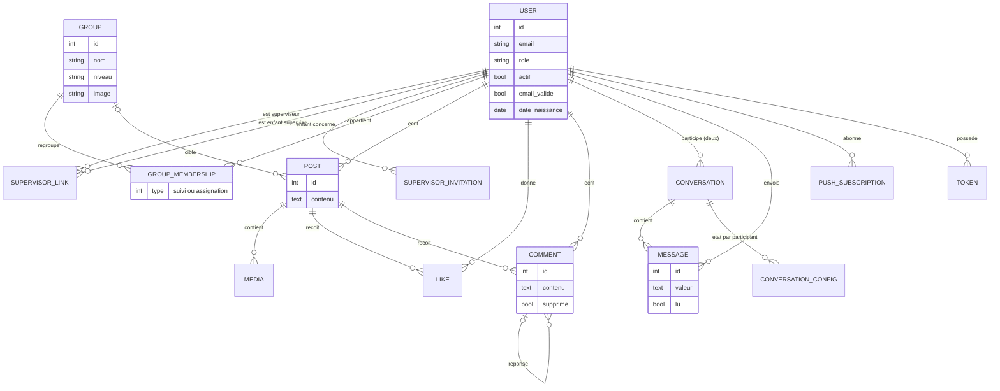

# Cahier des Charges Fonctionnel (CDCF) : Centre Art & Danse

> **Document de référence** : cahier des charges fonctionnel de l'application web et mobile (PWA) de gestion de l'école de danse « Centre Art & Danse ».
> **Version** : 1.0
> **Date** : 06/11/2026
> **Rédigé par** : Ecaterina Munteanu (développeuse, VNWeb)

---

## 1. Présentation générale du projet

### 1.1 Contexte
« Centre Art & Danse » est une école de danse. Son dirigeant, par ailleurs administrateur de l'application, ajoute et gère les professeurs, les parents et les élèves. L'application est développée et maintenue par l'agence VNWeb (Antibes), pour le compte de la direction de l'école, cliente de VNWeb.

L'application est en production et utilisée au quotidien. Ce document décrit le comportement attendu de l'application et les évolutions prévues. Les composants applicatifs sont : l'interface (application installable sur téléphone), l'interface de programmation (serveur) et un service dédié de dépôt et de diffusion des fichiers.

### 1.2 Problématique
Avant l'application, l'école communiquait en écrivant à chaque famille individuellement. L'application répond à trois difficultés :
- diffuser une information à un groupe de danse ou à toute l'école sans écrire à chacun ;
- permettre aux parents de suivre le parcours de leurs enfants ;
- centraliser la gestion des comptes (professeurs, parents, élèves) par la direction.

### 1.3 Objectifs du projet
- **Objectif métier** : centraliser la communication interne de l'école et la gestion de ses utilisateurs.
- **Objectif utilisateur** : permettre aux professeurs de publier une fois pour un groupe, et aux parents de suivre les groupes et cours de leurs enfants.
- **Objectif opérationnel** : donner à la direction la maîtrise des comptes (validation, suspension, suppression) et des cours.
- **Objectif de protection** : protéger les données des familles, en grande majorité des mineurs.

### 1.4 Vision du produit
Un outil interne, réservé au personnel et aux familles de l'école, qui remplace les messages envoyés un par un par des publications ciblées par groupe, une messagerie privée et des notifications, et qui s'installe sur le téléphone comme une application.

### 1.5 Périmètre du projet
**Inclus dans le périmètre**
- Comptes, rôles et cycle de vie des comptes.
- Supervision des enfants par leurs parents, invitation d'un second superviseur.
- Groupes et cours.
- Publications, mentions « j'aime », commentaires.
- Messagerie privée en un-à-un.
- Notifications push et courriels transactionnels.
- Dépôt et diffusion de médias.
- Espace d'administration.
- Exigences non fonctionnelles, dont sécurité et protection des données personnelles.

**Hors périmètre**
- Messagerie de groupe (la communication de groupe passe par les publications).
- Paiement, facturation, planning de cours, gestion de la présence.
- Compte propre pour un enfant de moins de 15 ans (son profil est géré par un parent).
- Réécriture de l'application.
- Rôle « visiteur » non connecté : seules les pages de connexion, d'inscription et de mot de passe oublié sont accessibles sans compte.

### 1.6 Définitions et acronymes
| Terme | Définition |
|---|---|
| PWA | Application web installable sur un téléphone comme une application, sans passer par une boutique d'applications |
| Notification push | Message reçu sur l'appareil même lorsque l'application est fermée |
| Superviseur | Parent ou tuteur lié à un ou plusieurs élèves |
| Groupe | Entité nommée regroupant des cours (exemple : « Jazz moderne ») |
| Cours | Classe concrète rattachée à un groupe, définie par un nom de groupe, un niveau et une photo |
| Publication (ou post) | Message publié par un professeur ou l'administrateur, global ou rattaché à un groupe |
| Suspension | Désactivation d'un compte sans suppression de ses données |
| RGPD | Règlement général sur la protection des données |
| MoSCoW | Méthode de priorisation : Must (indispensable), Should (important), Could (souhaitable), Won't (exclu) |
| WCAG | Règles internationales d'accessibilité des contenus web |

## 2. Utilisateurs et parties prenantes

### 2.1 Public cible
Le personnel (professeurs), la direction, les parents ou tuteurs, et les élèves de l'école. La majorité des utilisateurs sont des enfants : les élèves de 15 ans ou plus ont un compte propre, les moins de 15 ans n'ont pas de compte autonome et sont gérés par un parent.

### 2.2 Profils utilisateurs et rôles

| Rôle | Description | Objectifs principaux | Droits / permissions |
|---|---|---|---|
| Administrateur | Dirigeant de l'école | Gérer comptes, cours et contenus | Tous les droits, espace d'administration, suppression de publications, création de publications |
| Professeur | Enseignant | Informer ses groupes | Créer des publications, s'assigner à un groupe ou s'en retirer, commenter, messagerie |
| Superviseur | Parent ou tuteur d'un ou plusieurs élèves | Suivre ses enfants | Gérer le profil de ses enfants, inviter un autre superviseur, consulter, aimer, messagerie |
| Élève | Élève de l'école, rôle le plus limité | Suivre ses cours | Modifier ses cours et groupes suivis, consulter, aimer, messagerie. Compte propre à partir de 15 ans |
| Élève-superviseur | Élève qui est aussi parent d'un autre élève | Cumul des deux | Cumul des droits Élève et Superviseur |

Aucune autre combinaison de rôles n'existe : un professeur ne peut pas être également superviseur. Il n'existe pas de rôle visiteur.

### 2.3 Parties prenantes
| Partie prenante | Responsabilité / contribution |
|---|---|
| Commanditaire et référent métier | Direction de l'école de danse : exprime les besoins, valide les fonctionnalités et la recette |
| Responsable technique et priorités | Vincent Nilles, dirigeant de VNWeb et maître d'apprentissage : valide les orientations techniques et les priorités |
| Équipe de réalisation | Ecaterina Munteanu, développeuse en charge du projet |
| Utilisateurs finaux | Professeurs, parents, élèves |

## 3. Périmètre fonctionnel et fonctionnalités

### 3.1 Vue d'ensemble des modules

| ID | Module | Description | Priorité |
|---|---|---|---|
| MOD-001 | Authentification et comptes | Inscription, validation de l'adresse courriel, connexion, déconnexion, mot de passe oublié | Must |
| MOD-002 | Profil utilisateur | Consultation et modification du profil, changement d'adresse courriel | Must |
| MOD-003 | Supervision des enfants | Gestion des enfants, invitation d'un autre superviseur | Must |
| MOD-004 | Groupes et cours | Consultation, inscription et retrait d'un groupe | Must |
| MOD-005 | Publications | Publications globales et de groupe, mentions « j'aime », commentaires | Must (publications), Should (j'aime), Could (commentaires) |
| MOD-006 | Messagerie | Conversations privées en un-à-un en temps réel | Must |
| MOD-007 | Notifications | Notifications push et courriels transactionnels | Should |
| MOD-008 | Administration | Utilisateurs, validation des comptes, courriels non vérifiés, cours | Must |
| MOD-009 | Médias | Dépôt et diffusion de photos, avatars et médias de publications | Must |

L'application n'a pas de tableau de bord distinct : la page d'accueil affiche le fil de publications. La recherche est disponible dans l'espace d'administration.

### 3.2 Fiches détaillées des fonctionnalités

#### FCT-001 : Inscription d'un compte (15 ans ou plus)

- **Module :** MOD-001
- **Priorité :** Must have
- **Acteur(s) :** Élève de 15 ans ou plus (et toute personne adulte s'inscrivant avec un rôle d'élève ou de superviseur)
- **Objectif :** Créer son compte sans intervention préalable de la direction.
- **Description :** La personne remplit le formulaire d'inscription. Le compte est créé inactif et sans adresse validée ; un courriel de vérification est envoyé.
- **Préconditions :**
  - Adresse courriel non déjà utilisée par un autre compte.
  - Âge d'au moins 15 ans révolus.
- **Déclencheur :** Soumission du formulaire d'inscription.

**Scénario nominal**
1. La personne saisit adresse courriel, prénom, nom, date de naissance, mot de passe (8 caractères minimum) et type de compte.
2. Le système crée le compte avec adresse non validée et compte inactif.
3. Le système envoie le courriel de vérification (NOT-007) et affiche un message de succès.
4. Le compte reste inactif jusqu'à FCT-002 puis FCT-003.

**Scénarios alternatifs et cas d'erreur**
- Âge inférieur à 15 ans → inscription refusée avec un message explicite.
- Adresse déjà utilisée → inscription refusée.
- Mots de passe de confirmation différents → inscription refusée.

**Règles de gestion**
- RG-001, RG-002, RG-003, RG-004.

**Données manipulées**
- Adresse courriel (obligatoire, unique), prénom, nom (obligatoires), date de naissance (obligatoire), mot de passe (obligatoire, 8 caractères minimum), type de compte (obligatoire).

**Critères d'acceptation**
- [ ] Étant donné une personne de 15 ans ou plus avec une adresse inconnue, lorsqu'elle s'inscrit, alors un compte inactif est créé et un courriel de vérification est envoyé.
- [ ] Étant donné une personne de moins de 15 ans, lorsqu'elle tente de s'inscrire, alors l'inscription est refusée.

**Écrans concernés / références**
- SCR-002 (inscription, portée par la page de connexion).

---

#### FCT-002 : Validation de l'adresse courriel

- **Module :** MOD-001
- **Priorité :** Must have
- **Acteur(s) :** Tout compte à adresse non validée, Administrateur
- **Objectif :** Prouver que l'adresse courriel appartient à la personne.
- **Description :** Un lien reçu par courriel, valable une heure, valide l'adresse.
- **Préconditions :** Compte existant avec adresse non validée.
- **Déclencheur :** Clic sur le lien du courriel de vérification.

**Scénario nominal**
1. La personne ouvre le lien.
2. Le système vérifie que le lien est valable et non utilisé.
3. L'adresse est marquée validée et le lien est révoqué.
4. Les administrateurs reçoivent une notification push « Nouvelle inscription » (NOT-004).

**Scénarios alternatifs et cas d'erreur**
- Lien expiré ou déjà utilisé → le lien est refusé et la personne est invitée à demander un nouveau lien.
- Demande d'un nouveau lien alors qu'un lien est encore valable → refus avec message « lien déjà envoyé ».
- Demande d'un nouveau lien depuis un compte dont l'adresse est déjà validée → message « utilisateur déjà valide ».

**Règles de gestion**
- RG-005, RG-006.

**Données manipulées**
- Jeton de validation (unique, une heure), état de validation de l'adresse.

**Critères d'acceptation**
- [ ] Étant donné un lien valable, lorsque la personne l'ouvre, alors l'adresse est validée.
- [ ] Étant donné un lien de plus d'une heure, lorsque la personne l'ouvre, alors il est refusé.

**Écrans concernés / références**
- SCR-002 (page de validation du lien), SCR-009 (courriels non vérifiés, côté administrateur).

---

#### FCT-003 : Validation d'un compte par l'administrateur

- **Module :** MOD-008
- **Priorité :** Must have
- **Acteur(s) :** Administrateur
- **Objectif :** Contrôler qui accède à l'application.
- **Description :** Un compte auto-inscrit reste inactif après la validation du courriel, jusqu'à validation manuelle par l'administrateur.
- **Préconditions :** Compte auto-inscrit, adresse validée.
- **Déclencheur :** Action « valider » sur l'écran de validation.

**Scénario nominal**
1. L'administrateur ouvre l'écran de validation (SCR-008).
2. Il recherche et sélectionne un compte en attente.
3. Il valide le compte.
4. Le compte devient actif ; la personne peut se connecter.

**Scénarios alternatifs et cas d'erreur**
- Compte non trouvé → message d'erreur.
- Refus du compte → l'administrateur supprime le compte (FCT-018).

**Règles de gestion**
- RG-007.

**Données manipulées**
- État actif du compte.

**Critères d'acceptation**
- [ ] Étant donné un compte à adresse validée et inactif, lorsque l'administrateur le valide, alors la personne peut se connecter.
- [ ] Étant donné un compte inactif, lorsque la personne tente de se connecter, alors la connexion est refusée.

**Écrans concernés / références**
- SCR-008.

---

#### FCT-004 : Connexion et déconnexion

- **Module :** MOD-001
- **Priorité :** Must have
- **Acteur(s) :** Tous les rôles
- **Objectif :** Accéder à l'application.
- **Description :** Connexion par adresse courriel et mot de passe. La session dure un jour.
- **Préconditions :** Compte actif, adresse validée.
- **Déclencheur :** Soumission du formulaire de connexion.

**Scénario nominal**
1. La personne saisit adresse et mot de passe.
2. Le système vérifie les identifiants et l'état du compte.
3. Il ouvre une session valable un jour.
4. La personne arrive sur la page d'accueil.

**Scénarios alternatifs et cas d'erreur**
- Identifiants invalides → connexion refusée.
- Compte inactif ou adresse non validée → connexion refusée avec message dédié.
- Trois tentatives échouées en une minute pour la même adresse depuis la même adresse réseau → blocage de vingt minutes.
- Déconnexion → la session en cours est supprimée.

**Règles de gestion**
- RG-008, RG-009.

**Données manipulées**
- Adresse, mot de passe, jeton de session.

**Critères d'acceptation**
- [ ] Étant donné des identifiants valides et un compte actif, lorsque la personne se connecte, alors elle accède à l'accueil.
- [ ] Étant donné trois échecs consécutifs, lorsqu'une quatrième tentative est faite dans les vingt minutes, alors elle est refusée.

**Écrans concernés / références**
- SCR-002.

---

#### FCT-005 : Mot de passe oublié

- **Module :** MOD-001
- **Priorité :** Must have
- **Acteur(s) :** Tous les rôles
- **Objectif :** Retrouver l'accès à son compte.
- **Description :** Un lien de réinitialisation, valable une heure, est envoyé à l'adresse du compte.
- **Préconditions :** Compte existant.
- **Déclencheur :** Demande depuis la page de connexion.

**Scénario nominal**
1. La personne saisit son adresse courriel.
2. Le système envoie un courriel avec un lien de réinitialisation (NOT-008).
3. La personne ouvre le lien, saisit un nouveau mot de passe (8 caractères minimum) et choisit de déconnecter ou non ses autres appareils.
4. Le mot de passe est modifié.

**Scénarios alternatifs et cas d'erreur**
- Un lien valable existe déjà → aucun nouveau courriel (même réponse neutre).
- Lien expiré → refusé.

**Règles de gestion**
- RG-005, RG-004.

**Données manipulées**
- Adresse, jeton de réinitialisation, nouveau mot de passe, choix de déconnexion globale.

**Critères d'acceptation**
- [ ] Étant donné un compte existant, lorsque la personne demande un lien, alors un courriel est envoyé à l'adresse du compte.
- [ ] Étant donné un lien de plus d'une heure, lorsqu'il est utilisé, alors il est refusé.

**Écrans concernés / références**
- SCR-002, SCR-010 (nouveau mot de passe).

**Cas particulier.** Lorsqu'un compte rattaché à un superviseur valide son adresse, un courriel de réinitialisation lui est envoyé afin qu'il définisse son mot de passe.

---

#### FCT-006 : Consultation et modification du profil

- **Module :** MOD-002
- **Priorité :** Must have
- **Acteur(s) :** Tous les rôles
- **Objectif :** Tenir ses informations personnelles à jour.
- **Description :** Consultation et modification des informations personnelles, de la photo de profil et de l'adresse courriel.
- **Préconditions :** Utilisateur connecté.
- **Déclencheur :** Ouverture de la page Profil.

**Scénario nominal**
1. L'utilisateur ouvre son profil.
2. Il modifie des champs et enregistre.
3. Les modifications sont visibles à la reconnexion.

**Scénarios alternatifs et cas d'erreur**
- Changement d'adresse courriel → un courriel de confirmation (NOT-009) est envoyé à la nouvelle adresse ; l'ancienne reste active jusqu'au clic sur le lien.
- Photo de profil de plus de 2 Mo ou d'un format autre que jpg, png ou webp → refusée.

**Règles de gestion**
- RG-010, RG-011.

**Données manipulées**
- Prénom, nom, téléphone, adresse, code postal (5 caractères), ville, date de naissance, genre, photo de profil, adresse courriel.

**Critères d'acceptation**
- [ ] Étant donné un utilisateur connecté, lorsqu'il modifie son prénom, alors le nouveau prénom est visible à la reconnexion.
- [ ] Étant donné une photo de 3 Mo, lorsqu'elle est envoyée, alors elle est refusée.

**Écrans concernés / références**
- SCR-005.

---

#### FCT-007 : Gestion des enfants

- **Module :** MOD-003
- **Priorité :** Must have
- **Acteur(s) :** Superviseur, Élève-superviseur
- **Objectif :** Gérer le profil et les cours de ses enfants.
- **Description :** Lister ses enfants, en ajouter, modifier leurs informations et leurs groupes, retirer un enfant de l'application.
- **Préconditions :** Rôle Superviseur ou Élève-superviseur.
- **Déclencheur :** Page Profil, section « enfants ».

**Scénario nominal**
1. Le superviseur ajoute un enfant (prénom, nom, date de naissance, adresse courriel facultative, groupes).
2. Si l'enfant n'a pas d'adresse courriel, son compte est immédiatement actif. S'il en a une, un courriel de vérification lui est envoyé (NOT-007).
3. L'enfant est lié au superviseur.
4. Le superviseur peut ensuite modifier les informations et groupes de l'enfant, ou retirer l'enfant.

**Scénarios alternatifs et cas d'erreur**
- Retrait d'un enfant → suppression **définitive** du compte de l'enfant et de ses données associées (publications, messages, mentions, liens), après confirmation de l'utilisateur. Seul un superviseur lié à l'enfant peut le retirer.
- Adresse déjà utilisée → refus.

**Règles de gestion**
- RG-012, RG-013, RG-014.

**Données manipulées**
- Prénom, nom, date de naissance, adresse courriel (facultative), groupes suivis.

**Critères d'acceptation**
- [ ] Étant donné un superviseur, lorsqu'il ajoute un enfant sans adresse courriel, alors le compte est actif immédiatement.
- [ ] Étant donné un superviseur non lié à un enfant, lorsqu'il tente de retirer cet enfant, alors l'action est refusée.
- [ ] Étant donné un superviseur lié à un enfant, lorsqu'il retire l'enfant, alors le compte de l'enfant n'existe plus.

**Écrans concernés / références**
- SCR-005.

---

#### FCT-008 : Invitation d'un autre superviseur

- **Module :** MOD-003
- **Priorité :** Must have
- **Acteur(s) :** Superviseur, Élève-superviseur
- **Objectif :** Permettre à un second parent ou à un tuteur de superviser un enfant (cas des parents séparés).
- **Description :** Le superviseur saisit une ou plusieurs adresses courriel. Si l'adresse correspond à un compte existant, une notification push est envoyée ; sinon, un courriel d'invitation est envoyé. L'invitation n'a d'effet que si la personne invitée l'accepte (FCT-009).
- **Préconditions :** Enfant existant, de rôle Élève, lié au superviseur qui invite.
- **Déclencheur :** Action « inviter un superviseur » sur l'enfant.

**Scénario nominal**
1. Le superviseur choisit l'enfant et saisit une ou plusieurs adresses.
2. Le système enregistre une invitation par adresse (doublons ignorés).
3. Le système notifie la personne invitée (NOT-005 ou NOT-010).

**Scénarios alternatifs et cas d'erreur**
- Enfant introuvable ou n'ayant pas le rôle Élève → refus.
- Personne non liée à l'enfant ou n'ayant pas un rôle autorisé → refus.

**Règles de gestion**
- RG-015, RG-016.

**Données manipulées**
- Adresses courriel invitées, identifiant de l'enfant.

**Critères d'acceptation**
- [ ] Étant donné un superviseur lié à un enfant, lorsqu'il invite une adresse, alors une invitation en attente est créée et la personne est notifiée.
- [ ] Étant donné une invitation non acceptée, alors aucun lien de supervision n'existe.
- [ ] Étant donné un utilisateur non lié à l'enfant, lorsqu'il tente d'inviter pour cet enfant, alors l'invitation est refusée.

**Écrans concernés / références**
- SCR-005 (fenêtre d'invitation).

---

#### FCT-009 : Acceptation ou refus d'une invitation de supervision

- **Module :** MOD-003
- **Priorité :** Must have
- **Acteur(s) :** Personne invitée (compte existant)
- **Objectif :** Devenir superviseur d'un enfant après accord explicite.
- **Description :** La personne accepte ou refuse l'invitation depuis son profil.
- **Préconditions :** Invitation en attente pour son adresse.
- **Déclencheur :** Action « accepter » ou « refuser ».

**Scénario nominal**
1. La personne consulte ses invitations.
2. Elle accepte : le lien de supervision est créé et l'invitation supprimée.

**Scénarios alternatifs et cas d'erreur**
- Refus → l'invitation est supprimée, aucun lien.
- Déjà superviseur de cet enfant → message d'erreur.
- Invitation introuvable → message d'erreur.

**Règles de gestion**
- RG-015.

**Données manipulées**
- Invitation (adresse, enfant), lien de supervision.

**Critères d'acceptation**
- [ ] Étant donné une invitation, lorsque la personne accepte, alors elle voit l'enfant dans sa liste.
- [ ] Étant donné une invitation, lorsque la personne refuse, alors aucun lien n'est créé.

**Écrans concernés / références**
- SCR-005.

---

#### FCT-010 : Consultation des groupes, professeurs et élèves

- **Module :** MOD-004
- **Priorité :** Must have
- **Acteur(s) :** Tous les rôles
- **Objectif :** Connaître l'offre de l'école.
- **Description :** Liste des groupes, des professeurs et des élèves, page détaillée d'un groupe avec ses publications.
- **Préconditions :** Utilisateur connecté.
- **Déclencheur :** Ouverture de la page Groupes.

**Scénario nominal**
1. L'utilisateur ouvre la page Groupes.
2. Il consulte les groupes, les professeurs et les élèves.
3. Il ouvre un groupe pour voir ses publications.

**Scénarios alternatifs et cas d'erreur**
- Aucun groupe → état vide (voir 4.3).

**Règles de gestion**
- RG-017.

**Données manipulées**
- Groupes (nom, niveau, image), professeurs, élèves.

**Critères d'acceptation**
- [ ] Étant donné un utilisateur connecté, lorsqu'il ouvre la page Groupes, alors les trois listes s'affichent.

**Écrans concernés / références**
- SCR-004.

---

#### FCT-011 : Rejoindre ou quitter un groupe

- **Module :** MOD-004
- **Priorité :** Must have
- **Acteur(s) :** Professeur, Administrateur (assignation), Élève (suivi), Superviseur pour ses enfants
- **Objectif :** Gérer ses groupes et cours.
- **Description :** Un professeur s'assigne à un groupe ou s'en retire. Un élève modifie les groupes qu'il suit. Ces actions sont en libre-service, sans validation d'un tiers.
- **Préconditions :** Utilisateur connecté.
- **Déclencheur :** Action « rejoindre » ou « quitter » sur un groupe.

**Scénario nominal**
1. L'utilisateur choisit un ou plusieurs groupes.
2. Le système enregistre l'appartenance (suivi ou assignation).
3. La modification est immédiate.

**Scénarios alternatifs et cas d'erreur**
- Aucun groupe sélectionné → refus.
- Groupe inexistant → refus.

**Règles de gestion**
- RG-018.

**Données manipulées**
- Appartenance utilisateur-groupe et type (suivi ou assignation).

**Critères d'acceptation**
- [ ] Étant donné un élève, lorsqu'il rejoint un groupe, alors le groupe apparaît sur son profil.

**Écrans concernés / références**
- SCR-004, SCR-005.

---

#### FCT-012 : Publier

- **Module :** MOD-005
- **Priorité :** Must have
- **Acteur(s) :** Administrateur, Professeur
- **Objectif :** Informer l'ensemble de l'école ou un groupe.
- **Description :** Création d'une publication textuelle, avec jusqu'à dix médias (photos, vidéos), rattachée à un groupe ou globale.
- **Préconditions :** Rôle Administrateur ou Professeur.
- **Déclencheur :** Action « publier » sur l'accueil ou la page d'un groupe.

**Scénario nominal**
1. L'utilisateur rédige un texte, ajoute des médias, choisit le groupe (ou global).
2. Il publie.
3. La publication apparaît dans le fil et les destinataires sont notifiés (NOT-001, NOT-002).

**Scénarios alternatifs et cas d'erreur**
- Rôle non autorisé → refus.
- Plus de dix médias → refus.
- Média trop volumineux ou de format non accepté → refus.

**Règles de gestion**
- RG-019, RG-020.

**Données manipulées**
- Contenu (texte, facultatif), groupe (facultatif), médias (jpg, jpeg, png, webp, webm, mov, ogg, mp4).

**Critères d'acceptation**
- [ ] Étant donné un professeur, lorsqu'il publie dans un groupe, alors seuls les membres du groupe voient la publication.
- [ ] Étant donné un élève, lorsqu'il tente de publier, alors l'action est impossible.

**Écrans concernés / références**
- SCR-001, SCR-004.

---

#### FCT-013 : Consulter le fil et aimer une publication

- **Module :** MOD-005
- **Priorité :** Must (consultation), Should (j'aime)
- **Acteur(s) :** Tous les rôles
- **Objectif :** Suivre l'actualité de l'école.
- **Description :** Le fil affiche les publications globales et celles des groupes de l'utilisateur. Chaque utilisateur peut aimer une publication une seule fois.
- **Préconditions :** Utilisateur connecté.
- **Déclencheur :** Ouverture de la page d'accueil ou d'un groupe.

**Scénario nominal**
1. L'utilisateur ouvre l'accueil.
2. Il lit les publications.
3. Il aime une publication ; le compteur augmente.

**Scénarios alternatifs et cas d'erreur**
- Second clic du même utilisateur → le « j'aime » est retiré.

**Règles de gestion**
- RG-021.

**Données manipulées**
- Publications, mentions « j'aime ».

**Critères d'acceptation**
- [ ] Étant donné une publication de groupe, lorsqu'un utilisateur hors du groupe ouvre l'accueil, alors il ne la voit pas.
- [ ] Étant donné un « j'aime » existant, lorsque le même utilisateur clique à nouveau, alors son « j'aime » est retiré et le compteur diminue d'une unité.

**Écrans concernés / références**
- SCR-001, SCR-004.

---

#### FCT-014 : Commenter une publication

- **Module :** MOD-005
- **Priorité :** Could have
- **Acteur(s) :** Tous les rôles selon les règles ci-dessous
- **Objectif :** Réagir à une publication.
- **Description :** Ajout de commentaires et de réponses, suppression par l'auteur ou l'administrateur.
- **Préconditions :** Utilisateur connecté.
- **Déclencheur :** Saisie dans la zone de commentaire sous une publication.

**Scénario nominal**
1. L'utilisateur saisit un commentaire sous une publication.
2. Le commentaire s'affiche (fil de réponses possible).

**Scénarios alternatifs et cas d'erreur**
- Publication de groupe : seuls les membres du groupe et les administrateurs peuvent commenter.
- Suppression : réservée à l'auteur et à l'administrateur ; suppression logique (le commentaire est masqué, non effacé).

**Règles de gestion**
- RG-022.

**Données manipulées**
- Commentaire (texte), auteur, publication, commentaire parent.

**Critères d'acceptation**
- [ ] Étant donné un membre d'un groupe, lorsqu'il commente une publication du groupe, alors le commentaire s'affiche.
- [ ] Étant donné un tiers non administrateur, lorsqu'il tente de supprimer un commentaire d'autrui, alors l'action est refusée.

**Écrans concernés / références**
- SCR-001, SCR-004.

---

#### FCT-015 : Supprimer une publication

- **Module :** MOD-005
- **Priorité :** Must have
- **Acteur(s) :** Administrateur, auteur de la publication
- **Objectif :** Retirer un contenu inapproprié ou erroné.
- **Description :** L'administrateur ou l'auteur supprime une publication ; elle disparaît pour tous.
- **Préconditions :** Rôle Administrateur, ou être l'auteur de la publication.
- **Déclencheur :** Action « supprimer » sur une publication.

**Scénario nominal**
1. L'administrateur choisit « supprimer » et confirme.
2. La publication disparaît du fil de tous les utilisateurs.

**Scénarios alternatifs et cas d'erreur**
- Utilisateur ni administrateur ni auteur → action refusée.

**Règles de gestion**
- RG-023.

**Données manipulées**
- Publication, médias associés.

**Critères d'acceptation**
- [ ] Étant donné une publication supprimée, lorsque n'importe quel utilisateur ouvre le fil, alors elle n'apparaît plus.

**Écrans concernés / références**
- SCR-001, SCR-004.

---

#### FCT-016 : Messagerie privée

- **Module :** MOD-006
- **Priorité :** Must have
- **Acteur(s) :** Tous les rôles
- **Objectif :** Échanger en privé.
- **Description :** Conversations en un-à-un, en temps réel, avec indicateurs de saisie et de lecture ; masquage d'une conversation par chacun des deux participants.
- **Préconditions :** Utilisateur connecté ; destinataire actif.
- **Déclencheur :** Ouverture de la messagerie.

**Scénario nominal**
1. L'utilisateur choisit un destinataire dans la liste des utilisateurs actifs.
2. Il écrit un message.
3. Le destinataire le reçoit en temps réel et une notification push lui est envoyée (NOT-003).

**Scénarios alternatifs et cas d'erreur**
- Destinataire suspendu : n'apparaît pas dans la liste.
- Masquage d'une conversation → masquée pour l'utilisateur seul.
- Aucune conversation de groupe.

**Règles de gestion**
- RG-024, RG-025.

**Données manipulées**
- Conversation (deux participants), message (contenu, expéditeur, lu ou non, date).

**Critères d'acceptation**
- [ ] Étant donné deux utilisateurs actifs, lorsque l'un envoie un message, alors l'autre le reçoit en temps réel.
- [ ] Étant donné une conversation masquée par A, alors elle reste visible pour B.

**Écrans concernés / références**
- SCR-003.

---

#### FCT-017 : Notifications push

- **Module :** MOD-007
- **Priorité :** Should have
- **Acteur(s) :** Tous les rôles
- **Objectif :** Être informé sans ouvrir l'application.
- **Description :** L'utilisateur autorise les notifications ; le système en envoie selon les événements du tableau de la section 9.
- **Préconditions :** Autorisation donnée par l'utilisateur sur son appareil.
- **Déclencheur :** Événement (nouvelle publication, nouveau message, etc.).

**Scénario nominal**
1. L'utilisateur accepte les notifications.
2. Un événement se produit.
3. L'utilisateur concerné reçoit la notification, sauf l'auteur de l'action.

**Scénarios alternatifs et cas d'erreur**
- Autorisation refusée → aucune notification.
- Échec d'envoi → la notification est abandonnée sans bloquer l'action qui l'a déclenchée.

**Règles de gestion**
- RG-026.

**Données manipulées**
- Abonnement aux notifications (appareil, clés).

**Critères d'acceptation**
- [ ] Étant donné un événement de la section 9, lorsqu'il se produit, alors le destinataire attendu reçoit la notification et l'auteur ne la reçoit pas.

**Écrans concernés / références**
- SCR-006 (paramètres, activation).

---

#### FCT-018 : Administration des utilisateurs

- **Module :** MOD-008
- **Priorité :** Must have
- **Acteur(s) :** Administrateur
- **Objectif :** Gérer les comptes.
- **Description :** Statistiques, liste et recherche, création directe d'un compte, modification, suspension, suppression.
- **Préconditions :** Rôle Administrateur.
- **Déclencheur :** Ouverture de l'écran « Utilisateurs ».

**Scénario nominal**
1. L'administrateur ouvre l'écran.
2. Il recherche un utilisateur et choisit une action : modifier, suspendre, supprimer, ou crée un compte.

**Scénarios alternatifs et cas d'erreur**
- Création : le compte est actif ; un courriel de vérification est envoyé, la personne valide son adresse puis définit son mot de passe. Elle ne peut pas se connecter avant d'avoir validé son adresse.
- Suspension : le compte est désactivé, ses données sont conservées, il n'apparaît plus dans la messagerie et ne peut plus se connecter.
- Suppression (et « bannissement ») : une seule opération, suppression définitive du compte et des données qui en dépendent (publications, commentaires, messages, liens de supervision). La suppression d'un parent n'entraîne pas celle de ses enfants : seul le lien de supervision disparaît, et l'administrateur est averti des enfants restés sans superviseur.

**Règles de gestion**
- RG-027, RG-028.

**Données manipulées**
- Compte utilisateur (voir 8.1).

**Critères d'acceptation**
- [ ] Étant donné un compte suspendu, lorsque la personne tente de se connecter, alors la connexion est refusée.
- [ ] Étant donné un compte supprimé, lorsqu'on le recherche, alors il n'existe plus.

**Écrans concernés / références**
- SCR-007.

---

#### FCT-019 : Validation des comptes et courriels non vérifiés

- **Module :** MOD-008
- **Priorité :** Must have
- **Acteur(s) :** Administrateur
- **Objectif :** Contrôler les inscriptions.
- **Description :** Écran de validation (recherche, validation, refus) et écran des courriels non vérifiés (liste, renvoi d'un lien valable une heure).
- **Préconditions :** Rôle Administrateur.
- **Déclencheur :** Ouverture des écrans correspondants.

**Scénario nominal**
1. L'administrateur consulte les comptes en attente.
2. Il valide ou refuse chaque compte ; pour les adresses non confirmées, il renvoie un lien.

**Scénarios alternatifs et cas d'erreur**
- Lien encore valable → message « lien déjà envoyé ».

**Règles de gestion**
- RG-007, RG-005.

**Données manipulées**
- Comptes inactifs, état de validation d'adresse.

**Critères d'acceptation**
- [ ] Étant donné un compte à adresse non vérifiée, lorsque l'administrateur renvoie le lien, alors un courriel est envoyé.

**Écrans concernés / références**
- SCR-008, SCR-009.

---

#### FCT-020 : Administration des cours

- **Module :** MOD-008
- **Priorité :** Must have
- **Acteur(s) :** Administrateur
- **Objectif :** Définir l'offre de cours.
- **Description :** Liste, recherche, création, modification et suppression des cours (nom de groupe, niveau, photo).
- **Préconditions :** Rôle Administrateur.
- **Déclencheur :** Ouverture de l'écran « Cours ».

**Scénario nominal**
1. L'administrateur crée un cours avec un nom de groupe (suggestions parmi les noms existants), un niveau et une photo.
2. Le cours apparaît sous son groupe.

**Scénarios alternatifs et cas d'erreur**
- Photo de plus de 2 Mo ou format autre que jpg, png, webp → refusée.
- Suppression d'un cours → disparition des appartenances associées.

**Règles de gestion**
- RG-029.

**Données manipulées**
- Nom, niveau, image.

**Critères d'acceptation**
- [ ] Étant donné deux cours de même nom de groupe, alors ils apparaissent sous le même groupe.

**Écrans concernés / références**
- SCR-011.

---

#### FCT-021 : Dépôt et diffusion de médias

- **Module :** MOD-009
- **Priorité :** Must have
- **Acteur(s) :** Utilisateurs autorisés (administrateur, professeur pour les publications ; tout utilisateur pour son avatar)
- **Objectif :** Illustrer cours, profils et publications.
- **Description :** Dépôt de photos de cours, avatars et médias de publications via un service de fichiers dédié ; les photos sont converties en format webp et les vidéos compressées.
- **Préconditions :** Fichier d'un format accepté.
- **Déclencheur :** Ajout d'un fichier dans un formulaire.

**Scénario nominal**
1. L'utilisateur choisit un fichier.
2. Le fichier est déposé, traité et son adresse est enregistrée.

**Scénarios alternatifs et cas d'erreur**
- Format ou taille non accepté → refus (voir ENF-012).

**Règles de gestion**
- RG-019, RG-010.

**Données manipulées**
- Fichiers (photos, vidéos), adresses de diffusion.

**Critères d'acceptation**
- [ ] Étant donné un fichier valide, lorsqu'il est déposé, alors il est consultable depuis l'application.

**Écrans concernés / références**
- SCR-001, SCR-004, SCR-005, SCR-011.

---

## 4. Parcours utilisateurs et navigation

### 4.1 Parcours principaux

#### PAR-001 : Inscription d'un élève de 15 ans ou plus
- **Acteur :** Élève
- **Objectif du parcours :** Obtenir un compte actif.
- **Point d'entrée :** Page de connexion, onglet inscription.
- **Point de sortie :** Page d'accueil connectée.

**Étapes**
1. L'élève remplit le formulaire d'inscription (FCT-001).
2. Il reçoit un courriel et ouvre le lien de vérification (FCT-002).
3. L'administrateur est notifié et valide le compte (FCT-003).
4. L'élève se connecte (FCT-004) et arrive sur l'accueil.

**Variantes / exceptions**
- Lien expiré : l'élève redemande un lien ou l'administrateur en renvoie un.
- Âge inférieur à 15 ans : inscription refusée, un parent doit créer le compte.

#### PAR-002 : Création du compte d'un enfant par un parent
- **Acteur :** Superviseur
- **Objectif :** Inscrire un enfant et le rattacher à des cours.
- **Point d'entrée :** Page Profil, section enfants.
- **Point de sortie :** Enfant visible dans la liste du parent.

**Étapes**
1. Le parent ouvre la fenêtre d'ajout d'un enfant.
2. Il saisit prénom, nom, date de naissance, adresse facultative, groupes.
3. Le système crée le compte et le lie au parent (FCT-007).

**Variantes / exceptions**
- Enfant avec adresse : courriel de vérification, puis définition du mot de passe.
- Adresse déjà utilisée : refus.

#### PAR-003 : Invitation d'un second superviseur
- **Acteur :** Superviseur, puis personne invitée
- **Objectif :** Associer un second parent ou un tuteur à un enfant.
- **Point d'entrée :** Page Profil, enfant concerné.
- **Point de sortie :** L'enfant apparaît dans la liste de la personne invitée.

**Étapes**
1. Le superviseur saisit l'adresse de la personne (FCT-008).
2. La personne est notifiée par push (compte existant) ou courriel (compte inexistant).
3. Elle se connecte (ou crée son compte), ouvre son profil, accepte l'invitation (FCT-009).

**Variantes / exceptions**
- Refus de la personne invitée : aucun lien.
- Personne déjà superviseur : message d'erreur.

#### PAR-004 : Publication dans un groupe
- **Acteur :** Professeur
- **Objectif :** Informer les membres d'un groupe.
- **Point d'entrée :** Page d'un groupe.
- **Point de sortie :** Publication visible, notifications envoyées.

**Étapes**
1. Le professeur s'assigne au groupe si nécessaire (FCT-011).
2. Il rédige une publication, ajoute des médias (FCT-012).
3. Les membres du groupe sont notifiés (sauf lui) et voient la publication.

**Variantes / exceptions**
- Média refusé : la publication n'est pas créée tant que le fichier n'est pas corrigé.

#### PAR-005 : Échange de messages privés
- **Acteur :** Tout utilisateur connecté
- **Objectif :** Échanger avec une autre personne de l'école.
- **Point d'entrée :** Page Messagerie.
- **Point de sortie :** Conversation affichée.

**Étapes**
1. L'utilisateur choisit un destinataire actif.
2. Il envoie un message (FCT-016).
3. Le destinataire reçoit le message et une notification.

**Variantes / exceptions**
- Conversation masquée puis nouveau message : la conversation réapparaît pour le destinataire.

### 4.2 Structure de navigation
Application à cinq entrées principales : Accueil (fil), Groupes, Messagerie, Profil, et, pour l'administrateur seulement, l'espace d'administration à quatre écrans (Utilisateurs, Validation, Courriels non vérifiés, Cours). La page de connexion (connexion, inscription, mot de passe oublié) est l'unique page accessible sans compte.

### 4.3 États particuliers
- Liste vide : un message explicite remplace la liste (exemple : « Soyez le premier à commenter »).
- Chargement : un indicateur de chargement s'affiche pendant l'attente.
- Succès : un message de confirmation s'affiche après chaque action.
- Erreur : un message d'erreur compréhensible, en français, s'affiche.
- Absence de connexion : l'utilisateur est informé que l'action n'a pas pu aboutir.
- Session expirée : au bout d'un jour, l'utilisateur est redirigé vers la page de connexion.

## 5. Exigences relatives à l'interface utilisateur (UI/UX)

### 5.1 Inventaire des écrans

| ID | Écran | Objectif | Utilisateurs concernés |
|---|---|---|---|
| SCR-001 | Accueil | Fil des publications globales et de ses groupes | Tous |
| SCR-002 | Connexion, inscription, mot de passe oublié, validation de lien | Accès et création de compte | Non connectés |
| SCR-003 | Messagerie | Conversations en un-à-un | Tous |
| SCR-004 | Groupes et détail d'un groupe | Consulter groupes, professeurs, élèves, publications d'un groupe | Tous |
| SCR-005 | Profil | Informations personnelles, enfants, invitations | Tous (enfants : superviseurs) |
| SCR-006 | Paramètres des notifications | Activer les notifications push | Tous |
| SCR-007 | Administration : Utilisateurs | Statistiques, recherche, création, modification, suspension, suppression | Administrateur |
| SCR-008 | Administration : Validation | Valider ou refuser les comptes en attente | Administrateur |
| SCR-009 | Administration : Courriels non vérifiés | Lister et relancer | Administrateur |
| SCR-010 | Nouveau mot de passe | Définir un mot de passe via un lien | Tous |
| SCR-011 | Administration : Cours | Créer, modifier, supprimer les cours | Administrateur |

### 5.2 Comportements attendus
- Navigation et retour : navigation par la barre principale ; retour au contexte précédent.
- Formulaires et champs : validation côté interface avant envoi ; mot de passe de 8 caractères minimum ; confirmation du mot de passe à l'inscription.
- Messages de confirmation : notification visuelle de succès après chaque action.
- Messages d'erreur : message explicite et en français ; les codes d'erreur du serveur sont traduits.
- États de chargement et états vides : voir 4.3.
- Adaptation mobile / tablette / ordinateur : application conçue d'abord pour le téléphone, en affichage plein écran et orientation portrait ; affichage utilisable sur tablette et ordinateur.
- Accessibilité : voir ENF-006.

### 5.3 Identité visuelle et ressources
Nom court de l'application : « CAD ». Le logo horizontal de l'école est utilisé dans l'application et dans les courriels. L'interface respecte une présentation cohérente d'un écran à l'autre (couleurs, typographie, composants).

## 6. Règles de gestion

| ID | Règle de gestion | Fonctionnalité(s) concernée(s) | Cas d'application |
|---|---|---|---|
| RG-001 | Une adresse courriel ne peut être associée qu'à un seul compte | FCT-001, FCT-007, FCT-018 | Inscription, création d'enfant ou de compte par l'administrateur |
| RG-002 | Un compte auto-inscrit est créé inactif, avec adresse non validée | FCT-001 | Inscription |
| RG-003 | L'inscription autonome exige 15 ans révolus, contrôlés par le système | FCT-001 | Inscription |
| RG-004 | Le mot de passe contient au moins 8 caractères | FCT-001, FCT-005 | Inscription, réinitialisation |
| RG-005 | Un lien de validation ou de réinitialisation est valable une heure | FCT-002, FCT-005, FCT-019 | Courriels transactionnels |
| RG-006 | Un nouveau lien n'est pas envoyé tant qu'un lien valable existe | FCT-002, FCT-019 | Renvoi |
| RG-007 | Un compte auto-inscrit ne se connecte qu'après validation de l'adresse puis validation de l'administrateur, sans exception | FCT-003, FCT-004 | Inscription |
| RG-008 | La connexion exige un compte actif et une adresse validée | FCT-004 | Connexion |
| RG-009 | Trois échecs de connexion en une minute entraînent un blocage de vingt minutes pour le couple adresse courriel et adresse réseau | FCT-004 | Connexion |
| RG-010 | Une photo de profil ou de cours ne dépasse pas 2 Mo et est au format jpg, png ou webp | FCT-006, FCT-020, FCT-021 | Dépôt d'image |
| RG-011 | Un changement d'adresse courriel est effectif après clic sur un lien envoyé à la nouvelle adresse | FCT-006 | Profil |
| RG-012 | Un enfant de moins de 15 ans n'a pas de compte autonome : il est créé et géré par un superviseur | FCT-007 | Création d'enfant |
| RG-013 | Un enfant créé sans adresse courriel est actif immédiatement ; avec adresse, il doit la valider | FCT-007 | Création d'enfant |
| RG-014 | Le retrait d'un enfant supprime définitivement son compte ; il est réservé à un superviseur lié à cet enfant | FCT-007 | Retrait |
| RG-015 | Une invitation de supervision n'a d'effet qu'après acceptation explicite ; une adresse ne peut être invitée qu'une fois par enfant | FCT-008, FCT-009 | Invitation |
| RG-016 | Seul un enfant de rôle Élève peut recevoir un second superviseur ; seul un superviseur lié à l'enfant peut inviter | FCT-008 | Invitation |
| RG-017 | Un utilisateur voit les publications globales et celles de ses groupes | FCT-010, FCT-013 | Fil |
| RG-018 | L'inscription à un groupe (suivi ou assignation) est en libre-service, sans validation d'un tiers | FCT-011 | Groupes |
| RG-019 | Une publication contient au plus dix médias (jpg, jpeg, png, webp, webm, mov, ogg, mp4) | FCT-012, FCT-021 | Publication |
| RG-020 | Seuls un administrateur et un professeur publient | FCT-012 | Publication |
| RG-021 | Un utilisateur aime une publication au plus une fois ; un nouveau clic retire son « j'aime » | FCT-013 | J'aime |
| RG-022 | Un commentaire de publication de groupe est réservé aux membres du groupe et aux administrateurs ; sa suppression est réservée à l'auteur et à l'administrateur ; la suppression est logique | FCT-014 | Commentaires |
| RG-023 | Seuls l'administrateur et l'auteur d'une publication peuvent la supprimer | FCT-015 | Suppression |
| RG-024 | La messagerie est exclusivement en un-à-un ; deux utilisateurs n'ont qu'une conversation | FCT-016 | Messagerie |
| RG-025 | Le masquage d'une conversation est individuel | FCT-016 | Messagerie |
| RG-026 | L'auteur d'une action ne reçoit pas la notification qu'elle déclenche | FCT-017 | Notifications |
| RG-027 | Un compte suspendu conserve ses données mais ne peut plus se connecter et sort de la liste de messagerie | FCT-018 | Suspension |
| RG-028 | Suppression et bannissement désignent la même opération : suppression définitive du compte et de ses données | FCT-018 | Suppression |
| RG-029 | Plusieurs cours de même nom de groupe apparaissent sous un même groupe ; catégories et niveaux sont libres | FCT-020 | Cours |

## 7. Exigences non fonctionnelles

| ID | Catégorie | Exigence | Niveau / critère attendu |
|---|---|---|---|
| ENF-001 | Sécurité : confidentialité des mineurs | Les données d'un enfant ne sont accessibles qu'aux superviseurs liés à cet enfant et à l'administrateur, pour toute consultation ou modification | Aucun accès aux données d'un enfant par un compte sans lien avec lui lors d'un test de contrôle d'accès |
| ENF-002 | Sécurité : authentification | Mot de passe de 8 caractères minimum ; session d'un jour ; double authentification pour les administrateurs et les superviseurs | 100 % des comptes administrateur protégés par double authentification |
| ENF-003 | Sécurité : tentatives répétées | Limitation à 3 échecs de connexion par minute, suivie d'un blocage de 20 minutes | Au quatrième essai pendant le blocage, refus |
| ENF-004 | Sécurité : réinitialisation | Limitation du nombre de demandes de réinitialisation du mot de passe et de renvoi de lien | Au-delà de 3 demandes par heure pour une même adresse, refus |
| ENF-005 | Protection des données personnelles | Conformité au RGPD : registre des traitements, base légale pour les mineurs et pour les comptes gérés par un parent, droit à l'effacement | Registre et base légale rédigés et validés par la direction |
| ENF-006 | Accessibilité | Respect du niveau WCAG 2.1 AA | Aucune anomalie bloquante de niveau A et AA sur les parcours principaux |
| ENF-007 | Performance | 95 % des pages chargées en moins de 3 secondes sur un réseau mobile courant | Mesure sur les parcours Accueil, Groupes, Messagerie |
| ENF-008 | Disponibilité | Disponibilité mensuelle de 99 % hors maintenance planifiée ; maintenance annoncée aux utilisateurs | Mesure mensuelle |
| ENF-009 | Compatibilité | Navigateurs récents (deux dernières versions majeures) sur Android, iOS et ordinateur ; installation sur l'écran d'accueil du téléphone | Parcours principaux vérifiés sur Chrome, Safari et Firefox |
| ENF-010 | Fiabilité | Les actions de suppression demandent une confirmation ; les erreurs affichent un message compréhensible ; la suppression d'un élément entraîne celle des données qui en dépendent | Aucune donnée orpheline ni perte non voulue lors d'une suppression |
| ENF-011 | Évolutivité | Accueillir la croissance du nombre d'utilisateurs de l'école sans refonte | Fonctionnement normal avec le double de la volumétrie actuelle |
| ENF-012 | Médias | Photos de profil et de cours : 2 Mo au plus (jpg, png, webp). Médias de publication : photos 5 Mo au plus, vidéos 100 Mo au plus, dix fichiers au plus. Seuls les utilisateurs connectés peuvent déposer un fichier | Fichier au-delà de la limite ou dépôt sans authentification refusé |
| ENF-013 | Chiffrement des échanges | Toutes les communications passent par HTTPS | Aucun accès non chiffré en production |
| ENF-014 | Traçabilité | Les connexions et les actions d'administration sensibles (validation, suspension, suppression) sont journalisées hors du serveur applicatif | Journaux consultables hors du serveur |
| ENF-015 | Qualité et recette | Chaque modification est vérifiée sur le parcours concerné avant mise en production ; un contrôle automatique de qualité et de sécurité s'exécute à chaque modification du code | Compte rendu par modification ; contrôle automatique réussi |

## 8. Données et gestion des informations

### 8.1 Données à collecter et traiter

| Donnée | Description | Format | Obligatoire ? | Source | Sensibilité / protection |
|---|---|---|---|---|---|
| Adresse courriel | Identifiant de connexion et contact | Texte (254) | Oui (facultative pour un enfant) | Utilisateur | Élevée |
| Mot de passe | Secret de connexion | Texte, haché | Oui | Utilisateur ou système | Élevée |
| Prénom, nom | Identité | Texte (255) | Nom : oui ; prénom : facultatif en base | Utilisateur, parent | Élevée, dont mineurs |
| Date de naissance | Âge et éligibilité | Date | Oui à l'inscription | Utilisateur, parent | Élevée, dont mineurs |
| Genre | Information de profil | male, female, unknown | Non (défaut : inconnu) | Utilisateur | Moyenne |
| Téléphone | Contact | Texte | Non | Utilisateur | Élevée |
| Adresse postale, code postal, ville | Coordonnées | Texte, code postal à 5 caractères | Non | Utilisateur | Élevée |
| Rôle et état du compte | Droits, activation, adresse validée | Valeurs fixes, booléens | Oui | Système | Moyenne |
| Lien parent-enfant | Rattachement, invitations | Identifiants | Oui pour un enfant | Utilisateur | Élevée |
| Groupes et cours | Appartenance, nom, niveau, image | Texte, identifiants | Non | Utilisateur, administrateur | Moyenne |
| Publications, commentaires, « j'aime » | Contenus | Texte, médias | Non | Utilisateur | Moyenne |
| Messages privés | Contenu des conversations | Texte | Non | Utilisateur | Élevée |
| Médias | Photos, avatars, vidéos | jpg, png, webp, mp4, etc. | Non | Utilisateur | Moyenne à élevée |
| Données techniques | Jetons de session et de validation, abonnements aux notifications | Texte | Système | Système | Élevée |

### 8.2 Règles de validation
- Format : adresse courriel valide ; code postal de 5 caractères ; date de naissance valide ; mot de passe d'au moins 8 caractères.
- Cohérence : âge minimum de 15 ans pour l'inscription autonome ; chaque enfant est lié à au moins un superviseur.
- Caractère obligatoire : adresse, nom, date de naissance, mot de passe, type de compte.
- Déduplication : une adresse par compte ; une paire parent-enfant unique ; un « j'aime » par utilisateur et publication ; une invitation par adresse et enfant ; une conversation par paire d'utilisateurs.

### 8.3 Accès, conservation et suppression
- Accès : chaque utilisateur ses données ; superviseur les données de ses enfants ; administrateur l'ensemble. Les messages privés ne sont accessibles qu'à leurs deux participants.
- Conservation : les données sont conservées tant que le compte est actif, puis supprimées ou anonymisées après 3 ans d'inactivité suivant le départ de l'élève.
- Exportation, rectification, suppression : rectification par l'utilisateur ou le superviseur ; suppression définitive par l'administrateur ou, pour un enfant, par le superviseur ; une demande d'export des données est traitée par l'administrateur.
- Sauvegarde et traçabilité : la base de données est sauvegardée quotidiennement ; les actions sensibles sont journalisées (ENF-014).

### 8.4 Modèle de données
Le modèle conceptuel des données (MCD) est fourni en annexe 15.2.

## 9. Notifications et communications

| ID | Événement déclencheur | Destinataire | Canal | Contenu / objectif | Conditions |
|---|---|---|---|---|---|
| NOT-001 | Nouvelle publication globale | Tous sauf l'auteur | Push | Informer d'une nouvelle publication | Abonnement actif |
| NOT-002 | Nouvelle publication de groupe | Membres du groupe sauf l'auteur | Push | Informer d'une nouvelle publication du groupe | Abonnement actif |
| NOT-003 | Nouveau message privé | Destinataire du message | Push | Informer d'un message | Abonnement actif |
| NOT-004 | Validation d'adresse par un utilisateur | Tous les administrateurs | Push | « Nouvelle inscription » | Abonnement actif |
| NOT-005 | Invitation à superviser un enfant (compte existant) | Personne invitée | Push | « Nouvelle invitation » | Abonnement actif |
| NOT-006 | Comptes à valider depuis plus d'une heure | Administrateurs | Push | Rappel de validation | Existence de comptes en attente |
| NOT-007 | Inscription, création d'un compte avec adresse | Titulaire de l'adresse | Courriel (« Vérification du compte ») | Lien de validation, une heure | Compte créé |
| NOT-008 | Demande de mot de passe oublié ; validation d'adresse d'un compte rattaché à un superviseur | Titulaire du compte | Courriel (« Réinitialisation du mot de passe ») | Lien de réinitialisation, une heure | Aucun lien valable existant |
| NOT-009 | Changement d'adresse courriel | Nouvelle adresse | Courriel (« Validation du nouvel email ») | Lien de confirmation | Demande de changement |
| NOT-010 | Invitation à superviser un enfant (adresse sans compte) | Personne invitée | Courriel (« Invitation à vous connecter ») | Lien vers l'application | Adresse inconnue |

Précisions :
- Expéditeur des courriels : noreply@centreartetdanse.com.
- Préférences configurables : l'utilisateur active ou désactive les notifications push depuis son appareil et l'application.
- Notifications obligatoires : les courriels de validation et de réinitialisation sont obligatoires.
- Fréquence et regroupement : une notification par événement, sans regroupement.
- Échec d'envoi : l'échec n'empêche pas l'action d'origine ; il est journalisé.

## 10. Interfaces et intégrations avec des systèmes externes

| ID | Système / service | Objectif | Données échangées | Sens de l'échange | Contraintes |
|---|---|---|---|---|---|
| INT-001 | Serveur d'envoi de courriels | Courriels transactionnels | Adresses, contenus, liens | Sortant | Dépend de la disponibilité du service |
| INT-002 | Services de notifications push des navigateurs (Web Push) | Notifications push | Abonnement, contenu court | Sortant | Les notifications transitent par le service du navigateur de l'utilisateur (Google, Apple, etc.) |
| INT-003 | Service de fichiers dédié (hébergé et maintenu par VNWeb) | Dépôt et diffusion des médias | Fichiers, adresses | Bidirectionnel | Limites des médias et authentification (ENF-012) |
| INT-004 | Lecteurs vidéo externes (liens intégrés) | Affichage de vidéos liées dans une publication | Adresse de la vidéo | Sortant | Dépend de la disponibilité du service vidéo |
| INT-005 | Extraction de métadonnées de liens | Aperçu de liens dans une publication | Adresse du lien | Sortant | Dépend de la disponibilité du site lié |

En cas d'indisponibilité d'un service externe, l'application reste utilisable : seule la fonction concernée (envoi de courriel, notification, aperçu) est indisponible.

## 11. Critères d'acceptation et stratégie de validation

### 11.1 Principes de validation
La recette est validée par le dirigeant de l'école, qui valide les exigences fonctionnelles. Vincent Nilles valide les priorités techniques. La recette se déroule sur l'environnement de préproduction avant toute mise en production. Chaque essai est documenté.

### 11.2 Cas de test d'acceptation

| ID | Fonctionnalité | Préconditions | Action / scénario | Résultat attendu | Statut |
|---|---|---|---|---|---|
| TEST-001 | FCT-001 | Adresse inconnue, 16 ans | S'inscrire | Compte inactif créé, courriel envoyé | À tester |
| TEST-002 | FCT-001 | Date de naissance : 14 ans | S'inscrire | Inscription refusée | À tester |
| TEST-003 | FCT-002 | Lien reçu depuis plus d'une heure | Ouvrir le lien | Lien refusé | À tester |
| TEST-004 | FCT-003 | Compte à adresse validée, inactif | L'administrateur valide, la personne se connecte | Connexion réussie | À tester |
| TEST-005 | FCT-004 | Compte actif | Trois échecs puis une tentative valide | Tentative refusée pendant le blocage | À tester |
| TEST-006 | FCT-005 | Compte existant | Demander un lien, l'ouvrir, saisir un nouveau mot de passe | Mot de passe modifié | À tester |
| TEST-007 | FCT-007 | Superviseur A, enfant de B | A tente de retirer l'enfant de B | Action refusée | À tester |
| TEST-008 | FCT-007 | Superviseur A, son enfant | A retire l'enfant | Compte de l'enfant supprimé | À tester |
| TEST-009 | FCT-008 | Superviseur lié à l'enfant | Inviter une adresse inconnue | Courriel d'invitation envoyé | À tester |
| TEST-010 | FCT-008 | Utilisateur non lié à l'enfant | Inviter pour cet enfant | Invitation refusée | À tester |
| TEST-011 | FCT-009 | Invitation en attente | Refuser | Aucun lien créé | À tester |
| TEST-012 | FCT-011 | Élève | Rejoindre un groupe | Groupe visible sur le profil | À tester |
| TEST-013 | FCT-012, FCT-013 | Professeur membre du groupe G | Publier dans G | Visible des membres de G seulement | À tester |
| TEST-014 | FCT-014 | Membre du groupe | Commenter | Commentaire affiché | À tester |
| TEST-015 | FCT-014 | Tiers non administrateur | Supprimer le commentaire d'autrui | Refusé | À tester |
| TEST-016 | FCT-016 | Deux utilisateurs actifs | Envoyer un message | Réception en temps réel | À tester |
| TEST-017 | FCT-018 | Compte suspendu | Se connecter | Refusé | À tester |
| TEST-018 | FCT-018 | Parent avec enfant | L'administrateur supprime le parent | L'enfant est encore présent, seul le lien est supprimé | À tester |
| TEST-019 | FCT-021 | Fichier de 3 Mo comme photo de profil | Envoyer | Refusé | À tester |
| TEST-020 | FCT-017 | Notification acceptée | Publier un post global | Les autres reçoivent la notification, pas l'auteur | À tester |

### 11.3 Conditions de validation
- Tous les cas de test des fonctionnalités de priorité Must réussis, ou écart accepté par écrit par le dirigeant de l'école.
- Aucune anomalie bloquante (perte de données, accès aux données d'un tiers, impossibilité de se connecter) acceptée.
- Livrables attendus : compte rendu de recette daté pour chaque modification importante, signé par le dirigeant de l'école.

## 12. Priorisation

Méthode MoSCoW. Le tableau classe les fonctionnalités de l'application et les évolutions prévues.

| Priorité | Signification | Fonctionnalités concernées |
|---|---|---|
| Must have | Indispensable au fonctionnement actuel | FCT-001 à FCT-012, FCT-015, FCT-016, FCT-018 à FCT-021 |
| Should have | Important | FCT-013 (j'aime), FCT-017 |
| Could have | Amélioration souhaitable | FCT-014 (commentaires) ; évolutions A-08 à A-10 |
| Won't have | Explicitement exclu | Messagerie de groupe, paiement, planning, présence |

### 12.1 Évolutions prévues

| ID | Évolution | Rattachement | Priorité |
|---|---|---|---|
| A-01 | Contrôler le lien superviseur-enfant sur toutes les opérations concernant un enfant (modification, invitation) | ENF-001, FCT-007, FCT-008 | Must |
| A-02 | Contrôler l'âge de 15 ans côté serveur et limiter le type de compte autorisé à l'inscription | FCT-001 | Must |
| A-03 | Authentifier le dépôt de fichiers et contrôler les formats et tailles | INT-003, ENF-012 | Must |
| A-04 | Restreindre l'accès au canal de messagerie en temps réel aux domaines de l'application | FCT-016 | Must |
| A-05 | Registre des traitements et base légale RGPD | ENF-005 | Must |
| A-06 | Double authentification pour administrateurs et superviseurs | ENF-002 | Should |
| A-07 | Limitation des demandes de réinitialisation | ENF-004 | Should |
| A-08 | Validation d'un tiers pour l'inscription à un groupe | FCT-011 | Could |
| A-09 | Unifier les deux indicateurs d'administrateur du modèle de données | 8.1 | Could |
| A-10 | Retirer les composants logiciels inutilisés | 10 | Could |

## 13. Contraintes, dépendances et hypothèses

### 13.1 Contraintes
- Budget : pas de budget dédié ; les évolutions sont réalisées dans le cadre de la maintenance de l'application.
- Délais et échéances : pas d'échéance imposée par le client ; les évolutions sont planifiées par ordre de priorité.
- Contraintes réglementaires ou contractuelles : RGPD, avec une attention particulière aux données des mineurs et aux élèves de moins de 15 ans dont le profil est géré par un parent.
- Contraintes organisationnelles : une seule développeuse en charge du projet ; priorités validées par Vincent Nilles.
- Contraintes techniques déjà imposées : technologies existantes conservées, sans réécriture ; toute modification est réalisée sans interruption de service ni perte de données.

### 13.2 Dépendances
- Direction de l'école : validation des fonctionnalités et de la recette.
- Vincent Nilles : validation des priorités.
- Hébergement des serveurs et du service de fichiers (VNWeb pour l'environnement de test, serveurs externes pour la préproduction et la production).
- Services de courriels et de notifications des navigateurs.

Environnements : quatre environnements sont utilisés : un serveur d'essai (pré-développement), un environnement de développement, la préproduction et la production. Le code est hébergé sur le serveur Gitea de VNWeb, avec un contrôle automatique à chaque modification.

### 13.3 Hypothèses
- La direction de l'école valide les évolutions avant leur mise en œuvre.
- L'inscription libre à un groupe reste la règle.
- La volumétrie reste celle d'une école de danse, de l'ordre de quelques centaines d'utilisateurs.

### 13.4 Risques identifiés

| Risque | Impact potentiel | Probabilité | Mesure de prévention / réponse |
|---|---|---|---|
| Accès aux données d'un enfant par un compte sans lien (modification d'enfant, invitation) | Élevé | Moyenne | Contrôle du lien superviseur-enfant (A-01) |
| Dépôt de fichiers par une personne non connectée ou de taille excessive | Élevé | Moyenne | Authentification du service et limites (A-03) |
| Accès au canal de messagerie depuis un site extérieur | Élevé | Moyenne | Restriction des origines (A-04) |
| Inscription d'un mineur de moins de 15 ans en contournant l'interface | Moyen | Faible à moyenne | Contrôle côté serveur (A-02) |
| Dépendance à une seule personne sur le projet | Élevé | Élevée | Documentation, tests, contrôle automatique |
| Absence de supervision et de détection d'incident | Moyen | Moyenne | Journalisation et alerte (ENF-014) |
| Parent supprimé, enfant sans superviseur | Moyen | Moyenne | Alerte de l'administrateur (FCT-018) |

## 14. Livrables et jalons

| Livrable / jalon | Description | Responsable | Date cible |
|---|---|---|---|
| Validation du CDCF | Validation du périmètre et des exigences | Direction de l'école, Vincent Nilles | Avant toute évolution |
| Évolutions Must (A-01 à A-05) | Mise en conformité avec les exigences de sécurité et de protection des données | Ecaterina Munteanu | En priorité |
| Évolutions Should et Could (A-06 à A-10) | Améliorations complémentaires | Ecaterina Munteanu | Après les évolutions Must |
| Recette | Exécution des tests d'acceptation TEST-001 à TEST-020 | Ecaterina Munteanu, validation par la direction | Avant chaque mise en production |

## 15. Annexes

### 15.1 Documents de référence
- Plan d'audit de sécurité.
- Plan d'action de sécurisation.
- Audit de conformité RGPD.

### 15.2 Modèle conceptuel des données

### 15.3 Matrice des droits

| Fonction | Administrateur | Professeur | Superviseur | Élève | Élève-superviseur |
|---|:-:|:-:|:-:|:-:|:-:|
| Consulter les publications globales et de ses groupes | Oui | Oui | Oui | Oui | Oui |
| Aimer une publication | Oui | Oui | Oui | Oui | Oui |
| Commenter (groupe : membres seulement) | Oui | Oui | Oui | Oui | Oui |
| Créer une publication | Oui | Oui | Non | Non | Non |
| Supprimer une publication (l'auteur peut supprimer la sienne) | Oui | Oui (la sienne) | Non | Non | Non |
| S'assigner à un groupe ou s'en retirer | Oui | Oui | Non | Non | Non |
| Modifier les cours et groupes qu'il suit | Non | Non | Non | Oui | Oui |
| Messagerie privée | Oui | Oui | Oui | Oui | Oui |
| Gérer ses enfants (ajout, modification, retrait) | Non | Non | Oui | Non | Oui |
| Inviter un superviseur pour un enfant | Non | Non | Oui | Non | Oui |
| Accéder à l'espace d'administration | Oui | Non | Non | Non | Non |

Correspondance des valeurs techniques de rôle : Administrateur = `ADMIN` (`admin`), Professeur = `PROFESSOR` (`professeur`), Superviseur = `SUPERVISOR` (`superviseur`), Élève = `STUDENT` (`élève`), Élève-superviseur = `STUDENT_SUPERVISOR` (`élève_superviseur`).

## 16. Validation du document

| Partie prenante | Nom | Rôle | Décision | Date |
|---|---|---|---|---|
| Direction de l'école | | Commanditaire et référent métier | | |
| VNWeb | Vincent Nilles | Maître d'apprentissage, validation des priorités techniques | | |
| VNWeb | Ecaterina Munteanu | Rédactrice | Rédigé | 06/11/2026 |
